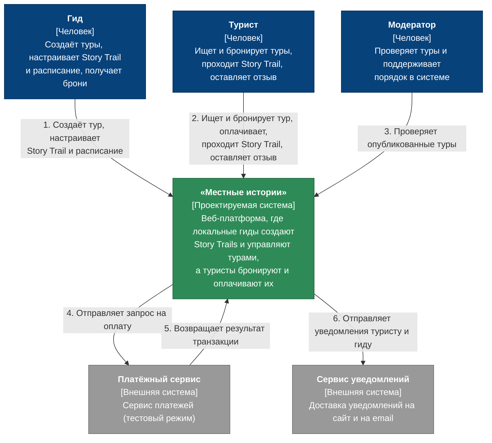
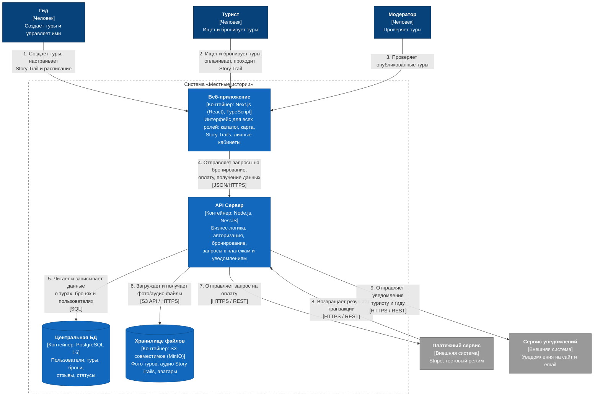

# ПЗ №10. Структура аналитической записки

**Группа:** ЭФБО-14-25  
**Команда:** ДенДанРо  
**Дата:** дд.мм.2026

Документ состоит из двух частей: бланки занятия (1–6) и текст «Аналитической записки» версии 0.1, оформленный по бланкам. В конце — раздел 4 «Требования и ограничения», написанный по заданию к ПЗ №11.

---

## Бланк 1. Опись документов

| Прил. | Документ | Версия или дата | Изменения из бланка 6 ПЗ №9 внесены? | Что пронумеровано для ссылок | Чего нет и что из этого следует для записки |
| :-- | :--- | :--- | :--- | :--- | :--- |
| 1 | «Видение продукта» и анализ аналогов | ПЗ №1 (16.09.2026), ПЗ №2 (25.09.2026) | Не требовались | Цели 1–5 (ПЗ №2, бланк 6); аналоги 1–6 | Мини-игра «Собери маршрут» есть в карточке продукта (ПЗ №1, Бланк Б), но её нет в границах «входит» (ПЗ №2, бланк 7) — вопрос в каркас раздела 8 |
| 2 | «Сценарии использования» | ПЗ №3 (09.10.2026) | Нет: уточнить UC1, 4а; добавить UC1, 7б; исправить UC1, 8а (бланк 6 ПЗ №9) — Денис | UC1–UC8; НФТ1–НФТ5 пронумерованы | В НФТ1 не указан порог p95 («p95 времени ответа <= 1%») — раздел 4 и раздел 6 (Р4) без числа |
| 3 | «Контекст системы» | ПЗ №4 (15.10.2026) | Не требовались | Связи 1–6 | В бланке 3 у Сервиса уведомлений описан обмен «запрос на оплату» — опечатка, исправить на «запрос на отправку уведомления» |
| 4 | «Контейнеры системы» | ПЗ №5 (23.10.2026) | Нет: бланк 4, НФТ2 — ссылка на ADR-001; «Что не показано» — ссылка на ADR-002 — Руслан | Связи 1–9 (К1–К6 из контекста) | В бланке 4 номера НФТ не совпадают с ПЗ №3: «НФТ 3: Оплата в тестовом режиме» (в ПЗ №3 это НФТ5), «НФТ 4: Безопасность и роли» (в ПЗ №3 НФТ4 — время публикации тура). Исправить нумерацию |
| 5 | «Компоненты контейнера» | ПЗ №6 (30.10.2026) | Нет: связь 12, подписи связей 4 и 9, ответственность Booking Module — Руслан | Связи 1–11 (+12 из ADR-001) | — |
| 6 | «Модель данных» и дополнение | ПЗ №7 (30.10.2026), ПЗ №8, бланк 4 | Нет: атрибуты `expires_at`, `payment_session_id`, уточнение П2 — Руслан | Сущности (8), связи 1–9, правила П1–П5 | — |
| 7 | «Выбор технологического стека» | ПЗ №8 (13.11.2026) | Нет: часть В бланка 4 — ссылка на ADR-001 вместо EXCLUDE — Руслан | Источники К1–К3 | Prisma ORM упомянута (бланки 2, 5), но не внесена в реестр решений бланка 1 |
| 8 | «Архитектурные решения» | ПЗ №9 | — | ADR-001, ADR-002; источники И1–И7 | — |

---

## Бланк 2. Каркас записки и сведения о документе

| № | Раздел | Откуда берётся (документ, место) | Состояние | Кто отвечает, к какому занятию |
| :-- | :--- | :--- | :--- | :--- |
| - | Сведения о документе | Бланк 1 | Пишем на занятии | Степан |
| 1 | Общие положения | ПЗ №1, Бланк Б (описание продукта, результат к концу семестра); ПЗ №2, бланки 6–7 (цели, границы) | Перенести из документа; дописать, что входит в первую версию (мини-игра — после ответа, см. вопрос 1) | Степан, к ПЗ №13 |
| 2 | Заинтересованные стороны и их интересы | ПЗ №2, бланк 5; ПЗ №3, бланк 1 (акторы), бланк 4 («Заинтересованные стороны» UC1) | Перенести; добавить, от кого получены требования (заказчик Артём, переписка ПЗ №1) | Степан, к ПЗ №13 |
| 3 | Описание процессов деятельности | ПЗ №1, Бланк А (как гид работает сейчас: 6 ручных процессов со временем); ПЗ №2, бланк 3 (текущий способ) | Перенести из документа: «как сейчас» описано подробно | Денис, к ПЗ №13 |
| 4 | Требования и ограничения | ПЗ №3 (UC1–UC8, НФТ1–НФТ5, «Откуда значение»); ПЗ №7 (П1–П5); ПЗ №8 (ограничения); ADR-001 (допущения) | Написан к ПЗ №11 (см. конец документа) | Руслан, к ПЗ №11 |
| 5 | Основные технические решения | ПЗ №4–8 | Пишем на занятии | Денис, Руслан |
| 6 | Архитектурные решения и их обоснование | ПЗ №8; ADR-001, ADR-002 | Пишем на занятии | Степан |
| 7 | Обеспечение требований и согласованность | Бланки 4 ПЗ №5–6; правила ПЗ №7; матрица ПЗ №11 | Будет написан на ПЗ №11 | Руслан, к ПЗ №11 |
| 8 | Риски, допущения и открытые вопросы | Пометки «не подтверждено» ПЗ №8–9; условия пересмотра ADR-001, ADR-002; вопросы заказчику ПЗ №8–9 | Будет написан на ПЗ №12; уже есть 14 открытых вопросов (ниже) | Степан, к ПЗ №12 |
| 9 | Подготовка к вводу в действие | ПЗ №1, Бланк А (данные заказчика: туры, гиды, расписание в Google Calendar и таблицах) | Нужно дописать: у проекта есть заказчик — какие туры и слоты перенести из Google Calendar и Google Sheets, кого научить (гиды, модератор) | Степан, к ПЗ №13 |
| — | Приложения 1–8 (документы), 9 (список источников); глоссарий — к ПЗ №13 | Бланк 1; источники К1–К3 (ПЗ №8), И1–И7 (ПЗ №9) | Приложения 1–8 собраны; приложение 9 — собрать; глоссарий — к ПЗ №13 | Денис |

### Открытые вопросы, найденные при сборке (уйдут в раздел 8)

**Вопросы заказчику и к перечню Use Case:**

1. Входит ли мини-игра «Собери маршрут» в первую версию: она есть в карточке продукта (ПЗ №1) и в README, но не в границах «входит» (ПЗ №2) и не в перечне Use Case (ПЗ №3).
2. Сколько времени неоплаченная бронь удерживает слот (допущение ADR-001 — 30 мин).
3. Может ли на один слот записаться несколько туристов (допущение ADR-001 и П2 — один).
4. Удаляется ли тур с бронями навсегда или переводится в архив (ПЗ №8, вопрос 1).
5. Может ли оставить отзыв турист без оплаченной брони (ПЗ №1: «нельзя проверить подлинность» отзывов).
6. Как рассчитывается комиссия платформы (ПЗ №8: для MVP — 0%).

**Не выбрано или не обосновано:**

7. Порог p95 в НФТ1 не установлен.
8. Поставщик Email-сервиса не назван (ПЗ №8).
9. Откуда берутся координаты точек Story Trail: в ПЗ №4 — «из картографического сервиса», на диаграммах такого элемента нет; в README — Leaflet.
10. Node.js и NestJS выбраны без сравнения: довод — ограничение «Fullstack JS» и компетенции команды (ПЗ №8).
11. Next.js выбран без сравнения (ПЗ №8); MinIO — без сравнения (ПЗ №5, ПЗ №8).

**Не подтверждено:**

12. Поддержка частичного индекса в `schema.prisma` (ADR-001, И7).
13. Поведение Stripe при оплате на границе срока сессии (ADR-001).
14. Выполнение НФТ1 одним экземпляром API Сервера — до нагрузочного теста (ADR-002).

### Раздел «Сведения о документе»

| Поле | Содержание |
| :--- | :--- |
| **Система, документ** | Веб-платформа «Местные истории» (Story Trails). Аналитическая записка. |
| **Версия, дата** | 0.1, дд.мм.2026 |
| **Команда и кто за какой раздел отвечает** | Данков Степан — сведения о документе, разделы 1, 2, 6, 8, 9; Куксов Денис — раздел 3, раздел 5 (5.1–5.3), приложения; Романов Руслан — раздел 4, раздел 5 (5.4–5.8), раздел 7. |
| **Приложения (номер — документ — версия)** | 1 — «Видение продукта» и анализ аналогов (ПЗ №1–2); 2 — «Сценарии использования» (ПЗ №3); 3 — «Контекст системы» (ПЗ №4); 4 — «Контейнеры системы» (ПЗ №5); 5 — «Компоненты контейнера» (ПЗ №6); 6 — «Модель данных» (ПЗ №7 и дополнение ПЗ №8); 7 — «Выбор технологического стека» (ПЗ №8); 8 — «Архитектурные решения» (ПЗ №9: ADR-001, ADR-002); 9 — список источников. |
| **Как читать записку (1–2 фразы)** | Раздел 5 — что выбрано, раздел 6 — почему. Подробности — в приложениях; номера Use Case, НФТ, правил данных, связей и ADR — те же, что в приложениях. |

---

## Бланк 3. Раздел 5 «Основные технические решения»

| Подраздел | Главное, что должен понять читатель | Рисунок или ссылка на приложение | Источник в документах проекта |
| :--- | :--- | :--- | :--- |
| **5.1. Как построены представления** | Диаграммы построены по модели C4 и правилам курса: контекст, контейнеры, компоненты одного контейнера. Модель данных — по правилам ПЗ №7. Номера связей в тексте и на диаграммах совпадают. | Приложения 3–6 | ПЗ №4–7 |
| **5.2. Система и её окружение** | С платформой работают три роли: гид создаёт туры, Story Trail и расписание; турист ищет, бронирует, оплачивает тур, проходит Story Trail и оставляет отзыв; модератор проверяет туры. Внешних систем две: Платежный сервис (тестовый режим) и Сервис уведомлений. | Рисунок 1 — контекстная диаграмма | ПЗ №4, бланки 2–5 |
| **5.3. Структура системы** | Четыре контейнера: Веб-приложение (одно для всех ролей), API Сервер (бизнес-логика, права, бронирование), Центральная БД, Хранилище файлов. Веб-приложение обращается только к API Серверу; к хранилищам и внешним системам обращается только API Сервер. | Рисунок 2 — диаграмма контейнеров | ПЗ №5, бланки 2–5 |
| **5.4. Части серверной части** | API Сервер — пять компонентов: Auth Module, Tours Module, Booking Module, Payment Integration, Notifications. Правило П2 (двойные брони) выполняет Booking Module (ADR-001); роли проверяет Auth Module. | Приложение 5 | ПЗ №6, бланки 2–4; ADR-001 |
| **5.5. Взаимодействие со смежными системами** | Платежный сервис — Stripe в тестовом режиме: обмен начинает API Сервер (запрос на оплату), результат возвращает Платежный сервис (связь 12 после ADR-001). Сервис уведомлений — поставщик не назван; обмен начинает API Сервер. | Приложения 5, 8 | ПЗ №5, бланк 3; ПЗ №8; ADR-001 |
| **5.6. Информация и её организация** | Восемь сущностей в Центральной БД; медиафайлы — в Хранилище файлов, в БД только ссылки. Пять правил данных П1–П5; на выбор хранилища повлияло П2. | Приложение 6 | ПЗ №7, бланки 2–5; ПЗ №8, бланк 4 |
| **5.7. Программные средства** | Таблица ниже; статусы — как в ПЗ №8. | Приложение 7 | ПЗ №8, бланк 1 |
| **5.8. Что рассматривали и не выбрали** | Таблица ниже, со ссылками на причины. | Приложения 4, 7, 8 | ПЗ №5, ПЗ №8, ADR-001, ADR-002 |

**5.7. Программные средства** (статус — как в документе о стеке):

| Часть системы | Технология и версия | Статус |
| :--- | :--- | :--- |
| Веб-приложение | Next.js (React), TypeScript; версия в документе не указана (в репозитории — next 14.0.0) | Принято |
| API Сервер | Node.js, NestJS; версия не указана (в репозитории — @nestjs/core ^10) | Принято |
| Центральная БД | PostgreSQL 16; уровень изоляции — Read Committed (ADR-001) | Принято (сравнивалось с SQLite) |
| Хранилище файлов | S3-совместимое (MinIO) | Принято |
| Вход и права | JWT, Passport.js | Принято |
| Платежный сервис | Stripe (тестовый режим) | Принято |
| Сервис уведомлений | Email-сервис (в ПЗ №6 — Nodemailer) | Принято; поставщик не назван |
| Доступ к БД из API Сервера | Prisma ORM | Упомянута в ПЗ №8 (бланки 2, 5), в реестр решений не внесена |

**5.8. Что рассматривали и не выбрали:**

| Вариант | Где записана причина |
| :--- | :--- |
| SQLite для Центральной БД | Раздел 6, Р1; приложение 7, бланки 2–5 |
| Python / Django, PHP для серверной части | Приложение 7, бланк 1: ограничение «стек JavaScript/TypeScript» |
| Закрепление слота только после оплаты; блокировка строки слота без ограничения в схеме | Раздел 6, Р3; приложение 8, ADR-001 |
| EXCLUDE по пересечению интервалов как защита П2 | Приложение 8, ADR-001, «Контекст»: защищает пересечение слотов, а не П2 |
| Несколько экземпляров API Сервера с балансировщиком и репликой БД | Приложение 4, «Что не показано»; раздел 6, Р4; ADR-002 |

---

## Бланк 4. Раздел 6 «Архитектурные решения и их обоснование»

| Графа | Р1. Хранилище | Р2. Серверная часть | Р3. Защита правила П2 | Р4. Один экземпляр API Сервера | Р5. Одно Веб-приложение для всех ролей |
| :--- | :--- | :--- | :--- | :--- | :--- |
| **Решение и статус** | Центральная БД — PostgreSQL 16; принято (ПЗ №8) | Node.js, NestJS; принято (ПЗ №8) | Удержание слота неоплаченной бронью, частичный уникальный индекс (ADR-001); принято | Один экземпляр API Сервера и одна БД без балансировщика (ADR-002); принято | Одно Веб-приложение для гида, туриста и модератора; решение команды на ПЗ №5 |
| **Требования и факты** | П2, НФТ2 (UC1, шаг 4); П1, П3–П5 (ограничения схемы) | ОГ1 «стек JavaScript/TypeScript» (ПЗ №8); состав команды — фуллстек-разработчики (ПЗ №1, Бланк В) | П2, НФТ2; UC1, шаг 4, отклонения 4а, 7а, 8а, гарантированный результат; UC3; НФТ5 | НФТ1 (100 пользователей, порог p95 не установлен); ОГ2 (3 человека, семестр) | UC1–UC8: все роли работают через браузер (ПЗ №5, бланк 2, вопрос 1); НФТ6 «роли» — нет в ПЗ №3, только в ПЗ №1 (Бланк Б) |
| **Почему именно так** | Решающий критерий — защита от двойных броней средствами БД (П2) и строгие ограничения схемы (П3–П5); простоту SQLite команда отдала, так как есть `docker-compose.yml` (ПЗ №8, бланк 5) | Решающее — ограничение «Fullstack JS»: язык и фреймворк заданы составом команды и учебным требованием | Главный критерий Т4 — турист не платит за занятый слот; затем Т5 — защита на уровне БД, а не только кода | Требования, ради которого стоило бы платить за балансировщик и реплику, нет | Интерфейс один для всех ролей, разделение — правами в API Сервере |
| **Чем подтверждено и что не подтверждено** | Свойство из документации: PostgreSQL 16, разд. 5.4 Constraints [К3], 11.8 Partial Indexes [И1]. Не подтверждено: что двойной брони не будет в коде — до интеграционного теста | Решение команды по ограничению; альтернативы не сравнивались | Свойства из документации: [И1], [И2] (PostgreSQL 16, 11.8, 64.5), [И5], [И6] (Stripe). Не подтверждено: частичный индекс в `schema.prisma`; оплата на границе срока сессии | Оценка, не измерено: нагрузочного теста нет, порога p95 нет | Решение команды без сравнения |
| **Рассмотренные варианты и причина отказа от каждого** | SQLite: при записи блокирует файл БД целиком и не имеет EXCLUDE и настоящих ENUM — защиту П2 и П3 пришлось бы писать в коде [К2] | Python/Django, PHP — исключены ограничением, не сравнивались | Закрепление после оплаты: второй турист узнаёт о занятом слоте после оплаты, нужны возвраты. Блокировка строки слота без ограничения в схеме: правило держится только на коде | Несколько экземпляров с балансировщиком и репликой: нет требования, лишний контур развёртывания, реплика может показать занятый слот свободным | Альтернативы не сравнивались (отдельное приложение модератора не обсуждалось) |
| **Чем платим** | Отдельный сервис БД в Docker; риск сетевой задержки до БД (ПЗ №8, бланк 5) | Не оценивалось | Слот занят до 30 мин после ухода туриста; ручная SQL-миграция индекса; два новых атрибута брони | При падении экземпляра система недоступна целиком | Все роли грузят одно приложение; разграничение доступа к экранам — только в коде клиента и правах API |
| **Когда пересмотрим** | Если изменится способ защиты П2 (ADR-001) | Если ограничение «Fullstack JS» будет снято | Заказчик назовёт срок удержания меньше 30 мин; групповые брони; оплата на месте; тест покажет оплаченную, но отменённую бронь | Нагрузочный тест не выдержит НФТ1; появится требование к доступности | Если у модератора появятся функции, которые нельзя давать в одном приложении с туристом |
| **Где подробно** | Приложение 7, бланки 2–5 | Приложение 7, бланк 1 | Приложение 8, ADR-001 | Приложение 8, ADR-002; приложение 4, «Что не показано» | Приложение 4, бланк 2 |

**Введение раздела 6:** В разделе пять ключевых решений. Р1 и Р2 приняты на ПЗ №8, Р3 и Р4 записаны в форме ADR на ПЗ №9 (Р4 — решение ПЗ №5, оформленное записью ADR-002), Р5 принято на ПЗ №5 без сравнения. Записи ADR — в приложении 8.

---

## Бланк 5. Проверка по ISO/IEC/IEEE 42010 и сверка

### Часть А. Где в записке выполнен подраздел стандарта

| Подраздел раздела 6 ISO/IEC/IEEE 42010:2022 | Раздел записки | Итог |
| :--- | :--- | :--- |
| 6.1 Идентификация и обзор описания | Сведения о документе | Да |
| 6.2 Заинтересованные стороны | Раздел 2 — к ПЗ №13; пока — роли в 5.2 | Позже |
| 6.4 Интересы | Разделы 2 и 4 — к ПЗ №13 и ПЗ №11 | Позже |
| 6.6 Точки зрения | 5.1 | Да |
| 6.7 Представления | 5.2–5.4, 5.6; приложения 3–6 | Да |
| 6.8 Составные части представлений | Приложения 3–6: описания элементов, легенды, «Что не показано» | Частично: у контекстной диаграммы (ПЗ №4) перечень «Что не показано» пустой |
| 6.9 Соответствия и согласованность | Сверки ниже; раздел 7 — на ПЗ №11 | Частично |
| 6.10 Решения и обоснование | Раздел 6; приложение 8 | Да |
| 6.3 Перспективы; 6.5 Аспекты | — | В курсе не разбирается |

### Часть Б. Сверки

| Сверка | Да / нет | Что нашли и где исправили |
| :--- | :--- | :--- |
| 1. Контейнеры ↔ программные средства и документ о стеке | Нет | На диаграмме контейнеров (ПЗ №5) у Веб-приложения — «React», в ПЗ №8 — «Next.js (React), TypeScript»; у всех контейнеров — «предварительно», а ПЗ №8 предписывает убрать пометку у PostgreSQL. В ПЗ №8 — PostgreSQL 16, в `docker-compose.yml` — образ `postgres:15-alpine`. Исправить: в ПЗ №5 технологии привести к ПЗ №8; в `docker-compose.yml` — образ `postgres:16-alpine`. |
| 2. Хранилища ↔ модель данных | Да, с оговоркой | Центральная БД хранит все 8 сущностей, файлы — Хранилище файлов (в БД — ссылки MEDIA). Но в бланке 2 ПЗ №7 у Тура атрибут «статус (опубликован)», а на ER-диаграмме его нет; у Брони нет атрибутов ADR-001. Оговорка записана в 5.6; ER-диаграмму дополнить. |
| 3. Правила данных ↔ записи ADR | Нет | В ПЗ №8 (часть В бланка 4) защита П2 — «EXCLUDE … запрет пересечения диапазонов времени для одного гида», что защищает другое правило. Заменить ссылкой на ADR-001; у П2 в ПЗ №7 — «способ защиты — ADR-001». |
| 4. Текст разделов 5–6 ↔ диаграммы | Нет | На рисунке диаграммы контейнеров (PZ_5.drawio.png) нет обратной связи 8 «Платежный сервис → API Сервер» и подписей-действий у связей 4–9 (только технологии). На диаграмме компонентов (ПЗ №6) нет связи от Платежного сервиса — добавлена связь 12 (ADR-001). В mermaid-схеме ПЗ №4 у связи 2 нет «оставляет отзыв», хотя в бланке 4 есть. Рисунки 1–2 записки построены по таблицам связей (бланк 4 ПЗ №4, бланк 3 ПЗ №5); исходные диаграммы перерисовать. |
| 5. Статусы ↔ всюду | Нет | Пометка «предварительно» на диаграммах ПЗ №5–6 при статусе «Принято» в ПЗ №8. Email-сервис — «Принято» без названия поставщика: в 5.7 записано «поставщик не назван». Prisma ORM — без статуса: так и записано в 5.7. |
| 6. Акторы Use Case ↔ люди на контекстной диаграмме | Да | Гид, Турист, Модератор — акторы ПЗ №3 и люди на диаграмме ПЗ №4; Платежный сервис — актор-система и внешняя система. Сервис уведомлений не актор ПЗ №3 — добавлен на ПЗ №4 (записано там в сверке). |
| 7. Внешние системы: контекстная диаграмма ↔ диаграмма контейнеров | Да, с оговоркой | Обе внешние системы связаны с API Сервером (связи 7–9 ПЗ №5). Оговорка: в бланке 3 ПЗ №4 у Сервиса уведомлений описан обмен «запрос на оплату» — исправить на «запрос на отправку уведомления». |

---

## Бланк 6. Проверка соседней командой

**Команда-читатель:** «PETSWALK». Читателям передают только бланки 3 и 4, без пояснений. Время — 5 минут.

_Столбец «Ответ читателей» заполняет команда-читатель; два последних столбца — авторы после возврата бланка._

| Вопрос | Ответ читателей | Совпадает с замыслом? (авторы) | Что авторы исправили |
| :--- | :--- | :--- | :--- |
| 1. Из чего состоит система и с какими внешними системами она связана? | | | |
| 2. Решение Р__ (выбирают читатели): почему выбрано это, а не другое? | | | |
| 3. Чем команда платит за это решение? | | | |
| 4. Что будет, если изменится требование, на котором решение держится? | | | |
| 5. Одно утверждение без опоры (без номера требования, источника или статуса) | | | |

---
---

# Аналитическая записка. Веб-платформа «Местные истории». Версия 0.1

## Сведения о документе

**Система:** веб-платформа «Местные истории» (Story Trails).  
**Документ:** аналитическая записка.  
**Версия:** 0.1, дд.мм.2026.  
**Команда «ДенДанРо»:** Данков Степан — сведения о документе, разделы 1, 2, 6, 8, 9; Куксов Денис — раздел 3, подразделы 5.1–5.3, приложения; Романов Руслан — раздел 4, подразделы 5.4–5.8, раздел 7.

**Приложения:** 1 — «Видение продукта» и анализ аналогов (ПЗ №1–2); 2 — «Сценарии использования» (ПЗ №3); 3 — «Контекст системы» (ПЗ №4); 4 — «Контейнеры системы» (ПЗ №5); 5 — «Компоненты контейнера» (ПЗ №6); 6 — «Модель данных» (ПЗ №7, дополнение ПЗ №8); 7 — «Выбор технологического стека» (ПЗ №8); 8 — «Архитектурные решения» (ПЗ №9); 9 — список источников.

**Как читать:** раздел 5 — что выбрано, раздел 6 — почему. Подробности — в приложениях; номера Use Case, НФТ, правил данных, связей и решений — те же, что в приложениях.

## Оглавление

- Сведения о документе
- 1. Общие положения — _содержание — из ПЗ №1 (Бланк Б) и ПЗ №2 (бланки 6–7), будет написан к ПЗ №13_
- 2. Заинтересованные стороны и их интересы — _содержание — из ПЗ №2 (бланк 5) и ПЗ №3 (бланки 1, 4), будет написан к ПЗ №13_
- 3. Описание процессов деятельности — _содержание — из ПЗ №1 (Бланк А) и ПЗ №2 (бланк 3), будет написан к ПЗ №13_
- 4. Требования и ограничения — _написан к ПЗ №11 (ниже)_
- 5. Основные технические решения
- 6. Архитектурные решения и их обоснование
- 7. Обеспечение требований и согласованность — _будет написан на ПЗ №11 (подраздел 7.1) и к ПЗ №13_
- 8. Риски, допущения и открытые вопросы — _будет написан на ПЗ №12; каркас — 14 вопросов в бланке 2 ПЗ №10_
- 9. Подготовка к вводу в действие — _содержание — из ПЗ №1 (Бланк А: где заказчик ведёт туры и брони сейчас), будет написан к ПЗ №13_
- Приложения 1–9

## 5. Основные технические решения

### 5.1. Как построены представления

Диаграммы построены по модели C4 и правилам курса: контекстная диаграмма (приложение 3), диаграмма контейнеров (приложение 4) и диаграмма компонентов API Сервера (приложение 5). Модель данных построена по правилам ПЗ №7 (приложение 6). Номера связей на рисунках и в тексте совпадают с номерами в приложениях.

### 5.2. Система и её окружение

Рисунок 1. Контекстная диаграмма веб-платформы «Местные истории» (по бланку 4 приложения 3).

| Обозначение | Что означает |
| :--- | :--- |
| Синий блок | Человек (роль) |
| Зелёный блок | Проектируемая система |
| Серый блок | Внешняя программная система |
| Стрелка | Связь от того, кто начинает взаимодействие; номер — номер связи бланка 4 ПЗ №4 |

С платформой работают три роли. Гид создаёт тур, настраивает Story Trail и расписание (связь 1; UC2, UC4, UC8). Турист ищет и бронирует тур, оплачивает его, проходит Story Trail и оставляет отзыв (связь 2; UC1, UC3, UC5, UC7). Модератор проверяет туры (связь 3; UC6). Внешних систем две: платформа отправляет Платежному сервису запрос на оплату и получает результат транзакции (связи 4–5; UC3), а Сервису уведомлений — уведомления туристу и гиду (связь 6; UC1, UC2).

Что не показано: перечень «Что не показано» к контекстной диаграмме в приложении 3 не заполнен. Перевод денег гиду на диаграмме нет — он вне границ MVP и выполняется вручную администратором (приложение 3, бланк 3, вопрос 5).

### 5.3. Структура системы

Рисунок 2. Диаграмма контейнеров веб-платформы «Местные истории» (по бланку 3 приложения 4, технологии — по приложению 7).

| Обозначение | Что означает |
| :--- | :--- |
| Тёмно-синий блок | Человек (роль) |
| Синий прямоугольник | Контейнер системы |
| Синий цилиндр | База данных / хранилище |
| Серый прямоугольник | Внешняя программная система |
| Рамка пунктиром | Граница проектируемой системы |
| Стрелка | Связь от источника к получателю; номер — номер связи бланка 3 ПЗ №5; в квадратных скобках — технология |

Система состоит из четырёх контейнеров. Гид, турист и модератор работают через одно Веб-приложение (связи 1–3), которое обращается только к API Серверу (связь 4). API Сервер проверяет права, бронирует слоты и единственный обращается к Центральной БД (связь 5), Хранилищу файлов (связь 6) и внешним системам (связи 7–9).

Что не показано (сокращённо; полный перечень — приложение 4): физические серверы и хостинг — уровень развёртывания; количество экземпляров — один экземпляр API Сервера и одна БД, см. ADR-002; таблицы Центральной БД — в модели данных (приложение 6).

### 5.4. Части серверной части

API Сервер разбит на пять компонентов (приложение 5). Auth Module выполняет регистрацию, вход, выдачу JWT и проверку ролей «гид», «турист», «модератор». Tours Module ведёт туры, Story Trail, точки маршрута, медиафайлы и отзывы и обращается к Центральной БД и Хранилищу файлов. Booking Module ведёт слоты и брони и выполняет правило П2: удерживает слот неоплаченной бронью до срока оплаты, а двойную бронь отклоняет частичный уникальный индекс в Центральной БД (ADR-001). Payment Integration отправляет запросы Платежному сервису и принимает от него результат оплаты (связь 12, добавлена по ADR-001). Notifications формирует уведомления и передаёт их Сервису уведомлений. Типовые изменения — смена платёжного провайдера и добавление SMS — затрагивают по одному компоненту (приложение 5, бланк 4).

### 5.5. Взаимодействие со смежными системами

**Платежный сервис** — Stripe в тестовом режиме (НФТ5). Обмен начинает API Сервер: компонент Payment Integration создаёт сессию оплаты со сроком жизни, равным сроку удержания брони (связь 7). Результат оплаты Платежный сервис возвращает сам (связь 8; на уровне компонентов — связь 12 в Payment Integration); повторное событие игнорируется. Если Платежный сервис недоступен, бронь отменяется и слот свободен (UC1, отклонение 8а; ADR-001).

**Сервис уведомлений** — Email-сервис, поставщик не назван. Обмен начинает API Сервер (компонент Notifications, связь 9). Интерфейс описан только назначением связи; что происходит при недоступности сервиса, в документах проекта не записано — вопрос в каркас раздела 8.

### 5.6. Информация и её организация

В Центральной БД восемь сущностей: Пользователь, Тур, Story Trail, Точка маршрута, Слот, Бронь, Отзыв, Медиафайл (приложение 6). Сами файлы хранятся в Хранилище файлов, в БД — только ссылки; данные платёжной карты в системе не хранятся. Правил данных пять: П1 — email уникален; П2 — на один слот не больше одной брони в статусе pending или paid (способ защиты — ADR-001); П3 — статус брони из списка pending, paid, cancelled; П4 — оценка от 1 до 5; П5 — у тура есть гид. На выбор хранилища повлияли П2 и П3 (ПЗ №8). Оговорка: на ER-диаграмме у Тура нет атрибута статуса модерации, хотя он записан в бланке 2 приложения 6; у Брони нет атрибутов `expires_at` и `payment_session_id` из ADR-001 — диаграмму нужно дополнить.

### 5.7. Программные средства

| Часть системы | Технология | Статус |
| :--- | :--- | :--- |
| Веб-приложение | Next.js (React), TypeScript | Принято |
| API Сервер | Node.js, NestJS | Принято |
| Центральная БД | PostgreSQL 16; Read Committed | Принято (сравнивалось с SQLite) |
| Хранилище файлов | S3-совместимое (MinIO) | Принято |
| Вход и права | JWT, Passport.js | Принято |
| Платежный сервис | Stripe (тестовый режим) | Принято |
| Сервис уведомлений | Email-сервис (Nodemailer) | Принято; поставщик не назван |
| Доступ к БД | Prisma ORM | Не внесена в реестр решений ПЗ №8 |

### 5.8. Что рассматривали и не выбрали

| Вариант | Где причина |
| :--- | :--- |
| SQLite для Центральной БД | Раздел 6, Р1; приложение 7 |
| Python / Django, PHP для серверной части | Приложение 7, бланк 1 (ограничение) |
| Закрепление слота только после оплаты; блокировка строки слота без ограничения в схеме | Раздел 6, Р3; ADR-001 |
| EXCLUDE по пересечению интервалов как защита П2 | ADR-001, «Контекст» |
| Несколько экземпляров API Сервера с балансировщиком и репликой | Приложение 4, «Что не показано»; раздел 6, Р4; ADR-002 |

## 6. Архитектурные решения и их обоснование

В разделе пять ключевых решений. Р1 и Р2 приняты на ПЗ №8, Р3 и Р4 записаны в форме ADR на ПЗ №9 (Р4 — решение ПЗ №5, оформленное записью ADR-002), Р5 принято на ПЗ №5 без сравнения. Записи ADR приведены полностью в приложении 8.

| Графа | Р1. Хранилище | Р2. Серверная часть | Р3. Защита правила П2 | Р4. Один экземпляр API Сервера | Р5. Одно Веб-приложение |
| :--- | :--- | :--- | :--- | :--- | :--- |
| **Решение и статус** | PostgreSQL 16; принято | Node.js, NestJS; принято | ADR-001; принято | ADR-002; принято | Решение команды (ПЗ №5) |
| **Требования и факты** | П2, НФТ2; П1, П3–П5 | ОГ1; состав команды | П2, НФТ2; UC1 (шаг 4, 4а, 7а, 8а); UC3; НФТ5 | НФТ1; ОГ2 | UC1–UC8; роли — ПЗ №1, Бланк Б |
| **Почему именно так** | Защита П2 средствами БД, ограничения схемы для П3–П5 | Ограничение «Fullstack JS» | Т4: турист не платит за занятый слот; Т5: защита на уровне БД | Нет требования к нескольким экземплярам | Разделение ролей — правами API Сервера |
| **Чем подтверждено / что не подтверждено** | PostgreSQL 16, разд. 5.4, 11.8 [К3, И1]; не подтверждено в коде | Решение команды | [И1], [И2], [И5], [И6]; не подтверждено: индекс в Prisma, граница срока оплаты | Оценка, не измерено | Решение команды без сравнения |
| **Рассмотренные варианты** | SQLite — блокировка файла целиком, нет EXCLUDE и ENUM | Не сравнивались | Закрепление после оплаты — платёж за занятый слот; блокировка в коде — правило только на коде | Балансировщик + реплика — нет требования, реплика отстаёт | Не сравнивались |
| **Чем платим** | Отдельный сервис БД | Не оценивалось | Удержание слота до 30 мин; ручная миграция | Отказ экземпляра = недоступность | Одно приложение на все роли |
| **Когда пересмотрим** | При смене способа защиты П2 | При снятии ограничения | Условия ADR-001 | Условия ADR-002 | Новые функции модератора |
| **Где подробно** | Прил. 7 | Прил. 7, бланк 1 | Прил. 8, ADR-001 | Прил. 8, ADR-002 | Прил. 4, бланк 2 |

Развёрнутые доводы по каждой графе — в бланке 4 ПЗ №10 выше.

---
---

## Раздел 4 записки «Требования и ограничения» (задание к ПЗ №11)

### 4.1. Перечень Use Case (приложение 2)

| № | Название | Основной актор |
| :-- | :--- | :--- |
| UC1 | Забронировать тур | Турист |
| UC2 | Создать тур | Гид |
| UC3 | Оплатить бронь | Турист |
| UC4 | Настроить Story Trail | Гид |
| UC5 | Оставить отзыв | Турист |
| UC6 | Проверить тур | Модератор |
| UC7 | Пройти Story Trail | Турист |
| UC8 | Управлять расписанием | Гид |

### 4.2. Нефункциональные требования (приложение 2, бланк 8)

| № | Требование | Как проверить | Откуда значение |
| :-- | :--- | :--- | :--- |
| НФТ1 | При 100 одновременно активных пользователях каталог туров показывает результаты; порог p95 времени ответа **не установлен** (в ПЗ №3 записано «<= 1%») | Нагрузочный тест | Учебное; уточнить по журналу броней |
| НФТ2 | На один слот система принимает не больше одной брони; если два туриста одновременно пытаются занять слот, бронь создаётся только для одного | Тест одновременной записи | Правило (из ПЗ №1, риск двойных броней) |
| НФТ3 | Тур публикуется только после проверки модератором; попытка публикации без проверки отклоняется и записывается в журнал | Тест прав | Правило (из бланка 7 ПЗ №2) |
| НФТ4 | Время публикации тура гидом ≤ 15 минут от начала создания до отправки на модерацию | Наблюдение за гидом | Цель 1 из бланка 6 ПЗ №2 |
| НФТ5 | Оплата проводится только в тестовом режиме; реальные транзакции отсутствуют | Проверка конфигурации | Правило (из бланка 7 ПЗ №2) |

### 4.3. Правила данных (приложение 6, бланк 4)

| № | Правило | Владелец | Способ защиты |
| :-- | :--- | :--- | :--- |
| П1 | Email пользователя не повторяется | Auth Module | `UNIQUE(email)` (ПЗ №8) |
| П2 | На один слот не больше одной брони в статусе pending или paid; pending с истёкшим сроком переводится в cancelled до создания новой брони | Booking Module | ADR-001 |
| П3 | Статус брони — только pending, paid, cancelled | Booking Module | ENUM (ПЗ №8) |
| П4 | Оценка в отзыве от 1 до 5 | Tours Module | CHECK (ПЗ №8, бланк 2) |
| П5 | У каждого тура есть гид (создатель) | Tours Module | FK `guide_id` NOT NULL |

### 4.4. Ограничения

| № | Ограничение | Кто задал |
| :-- | :--- | :--- |
| ОГ1 | Стек — JavaScript / TypeScript (Fullstack JS); Python/Django и PHP не выбираются | Учебное требование и компетенции команды (ПЗ №8, бланк 1) |
| ОГ2 | Срок — один семестр; команда — 3 человека; учебный бюджет | ПЗ №1, Бланк А («Почему это проект») |

### 4.5. Допущения

- Неоплаченная бронь удерживает слот 30 минут — до ответа заказчика (ADR-001).
- На один слот — одна бронь, групповых броней нет — до ответа заказчика (ADR-001, П2).
- Перевод денег гиду выполняется вручную администратором, вне MVP (ПЗ №4, бланк 3).
- Комиссия платформы в MVP — 0% (ПЗ №8).
- Каталог читается из той же Центральной БД, что и брони; один экземпляр API Сервера (ADR-002).
