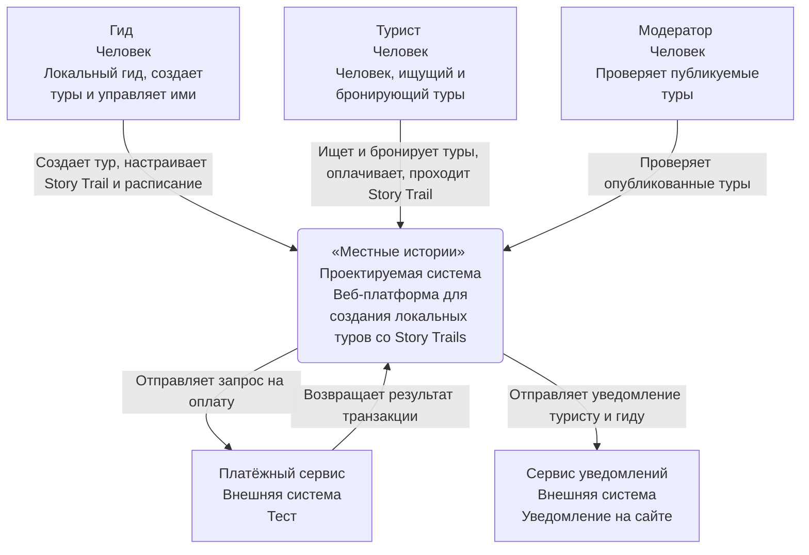

### 📄 Документ 4: `PZ4.md`

# ПЗ №4. Контекстная диаграмма

**Группа:** ЭФБО-14-25  
**Команда:** ДенДанРо  
**Дата:** 15.10.2026

## Памятка

| Правило                                                                                                                               | Проверка                                                                                  |
| :------------------------------------------------------------------------------------------------------------------------------------ | :---------------------------------------------------------------------------------------- |
| Система — один прямоугольник, «чёрный ящик»                                                                                           | Внутри нет приложений, баз данных?                                                        |
| Человек — роль в работе с системой (правило курса), а не конкретный человек; должность — только если её носят все, кто выполняет роль | Есть описание: кто это и зачем ему система?                                               |
| Внешняя система — как правило, за неё отвечает не ваша команда                                                                        | Своя база данных или своё серверное приложение не нарисованы как внешние системы?         |
| В каждом прямоугольнике три строки: название, тип, описание                                                                           | У каждого элемента подписано, кто это: человек, наша система или внешняя система?         |
| Связь — стрелка в одну сторону от того, кто начинает взаимодействие                                                                   | Подпись — действие источника, читается вместе с направлением? Нет «использует», «данные»? |
| Связь между двумя элементами окружения — только если без неё непонятно, как работает ваша система                                     | Стрелка от внешней системы идёт к человеку, который есть на диаграмме?                    |
| На контекстном уровне нет технологий                                                                                                  | Нет HTTPS, REST, SQL, названий фреймворков?                                               |
| У диаграммы есть название и легенда; сокращения понятны или расшифрованы                                                              | Поймёт ли диаграмму человек, который не был на занятии?                                   |

---

## Бланк 1. Проектируемая система

| Поле                                    | Значение                                                                                                              |
| :-------------------------------------- | :-------------------------------------------------------------------------------------------------------------------- |
| **Название** (как назовёт пользователь) | «Местные истории»                                                                                                     |
| **Назначение** (1–2 предложения)        | Веб-платформа, где локальные гиды создают Story Trails и управляют турами. А туристы бронируют и оплачивают этот тур. |

---

## Бланк 2. Люди-акторы

| Роль          | Описание для диаграммы (кто это и зачем система)                                                                                                                                                    | Актор в ПЗ №3 | Use Case           |
| :------------ | :-------------------------------------------------------------------------------------------------------------------------------------------------------------------------------------------------- | :------------ | :----------------- |
| **Гид**       | Человек, который создаёт туры, настраивает Story Trail и расписание, получает брони. Ему система нужна, чтобы публиковать впечатления и управлять ими без рутины. Получает брони в личном кабинете. | Да            | UC2, UC4, UC8      |
| **Турист**    | Человек, который ищет уникальный локальный опыт, бронирует и оплачивает тур, проходит Story Trail, оставляет отзыв.                                                                                 | Да            | UC1, UC3, UC5, UC7 |
| **Модератор** | Человек, который проверяет туры и поддерживает порядок в системе.                                                                                                                                   | Да            | UC6                |

---

## Бланк 3. Внешние программные системы

| Внешняя система        | Какой сервис даёт                | Какими данными обмениваемся и в какую сторону                                                                                                              | Кто начинает обмен | Use Case |
| :--------------------- | :------------------------------- | :--------------------------------------------------------------------------------------------------------------------------------------------------------- | :----------------- | :------- |
| **Платёжный сервис**   | Сервис платежей (тестовый режим) | Система -> платежный сервис (тест): запрос на оплату. Платёжный сервис -> Система: результат транзакции.                                                   | Система            | UC3      |
| **Сервис уведомлений** | Доставка уведомления на сайт     | Система -> Сервис уведомлений: запрос на оплату. Платёжный сервис -> Система: результат транзакции. _(Примечание: в исходном документе допущена опечатка)_ | Система            | UC1, UC2 |

### Ответы на вопросы поиска внешних систем

| Вопрос                                                              | Ответ                                                                                                                                                                                          |
| :------------------------------------------------------------------ | :--------------------------------------------------------------------------------------------------------------------------------------------------------------------------------------------- |
| **1. Откуда система берёт данные, которые не вводит пользователь?** | Координаты точек Story Trail – из картографического сервиса по клику гида. Данные о платеже – из платёжного сервиса. Данные о брони – генерируются системой на основе данных, введённых гидом. |
| **2. Как пользователь входит в систему?**                           | Через форму входа на сайте: email и пароль.                                                                                                                                                    |
| **3. Как доставляются уведомления?**                                | В личный кабинет пользователя на сайте и на email. Отправку выполняет внешний сервис уведомлений по запросу системы.                                                                           |
| **4. Куда система передаёт данные?**                                | Туристу и гиду – статусы броней и напоминания о турах. Платёжному сервису – запрос на оплату. Сервису уведомлений – запрос на отправку уведомления.                                            |
| **5. Кто принимает оплату (если она входит в продукт)?**            | Оплату принимает платёжный сервис (тестовый режим). Деньги поступают на счёт платформы. Перевод гиду – вне границ MVP: выполняется вручную администратором.                                    |

---

## Бланк 4. Связи

| №   | От               | К                  | Подпись: одно или несколько действий, без технологий                    | Use Case           |
| :-- | :--------------- | :----------------- | :---------------------------------------------------------------------- | :----------------- |
| 1   | Гид              | Система            | Создаёт тур, настраивает Story Trail и расписание                       | UC2, UC4, UC8      |
| 2   | Турист           | Система            | Ищет и бронирует тур, оплачивает, проходит Story Trail, оставляет отзыв | UC1, UC3, UC5, UC7 |
| 3   | Модератор        | Система            | Проверяет опубликованные туры                                           | UC6                |
| 4   | Система          | Платёжный сервис   | Отправляет запрос на оплату                                             | UC3                |
| 5   | Платёжный сервис | Система            | Возвращает результат транзакции                                         | UC3                |
| 6   | Система          | Сервис уведомления | Отправляет уведомления туристу и гиду                                   | UC1, UC2           |

---

## Бланк 5. Контекстная диаграмма

**Название диаграммы:** «Контекстная диаграмма работы проекта»
Для каждого элемента: название, тип, описание. Каждая стрелка подписана.

_(Визуализация контекстной диаграммы на основе Бланка 4 и исходного изображения)_

### Легенда (по исходному документу)

| Обозначение (цвет, форма, вид линии) | Что означает                |
| :----------------------------------- | :-------------------------- |
| Серый блок                           | Внешняя программная система |
| Синий блок                           | Человек (роль)              |
| Зелёный блок                         | Проектируемая система       |

---

## Бланк 5 (продолжение). Что не показано на диаграмме

| Что         | Почему не показано |
| :---------- | :----------------- |
| _(Пропуск)_ |                    |

---

## Бланк 6. Сверка

| Проверка                                                                                                              | До проверки: да/нет | Что исправлено                                                   | Итог: да/нет |
| :-------------------------------------------------------------------------------------------------------------------- | :------------------ | :--------------------------------------------------------------- | :----------- |
| 1. Люди на диаграмме совпадают с людьми-акторами ПЗ №3                                                                | Да                  | Все люди-акторы (Гид, Турист, Модератор) перенесены              | Да           |
| 2. Внешние системы совпадают с акторами-системами ПЗ №3                                                               | Да                  | Платёжный сервис из ПЗ №3; сервис уведомлений добавлен как новый | Да           |
| 3. Каждый Use Case отражён хотя бы в одной подписи связи                                                              | Да                  | UC1-UC8 отражены в подписях связей                               | Да           |
| 4. Ничего из «в продукт не входит» нет в назначении системы и подписях связей                                         | Да                  | Чат как доп. функция – не упоминается                            | Да           |
| 5. Внутри системы нет её частей; технологий нет в подписях, типах и описаниях                                         | Да                  | Технологии не указаны                                            | Да           |
| 6. У элементов — тип, описание и хотя бы одна связь, у стрелок — конкретные подписи, у диаграммы — название и легенда | Да                  | Все подписано, обозначено                                        | Да           |

---

## Бланк 7. Проверка читаемости

**Команда-читатель:** «PETSWALK»

| Вопрос                                                          | Ответ читателей (по диаграмме)                                                                                                                  | Совпадает с замыслом авторов? | Что авторы исправили |
| :-------------------------------------------------------------- | :---------------------------------------------------------------------------------------------------------------------------------------------- | :---------------------------- | :------------------- |
| **Что делает система?**                                         | Платформа для создания и бронирования локальных туров со Story Trails                                                                           | Да                            | -                    |
| **Кто ей пользуется и зачем?**                                  | Гид — создаёт туры; турист — бронирует и оплачивает; модератор — проверяет                                                                      | Да                            | -                    |
| **С какими внешними системами она связана и чем обменивается?** | Платёжный сервис (в тестовом режиме) — получает результат оплаты, передаёт запрос; сервис уведомлений — уведомляет пользователя пушем на сайте. | Да                            | -                    |
| **Что осталось непонятным?**                                    | Неясно, как именно турист проходит Story Trail — это отдельный Use Case или часть бронирования                                                  | Да                            | -                    |
