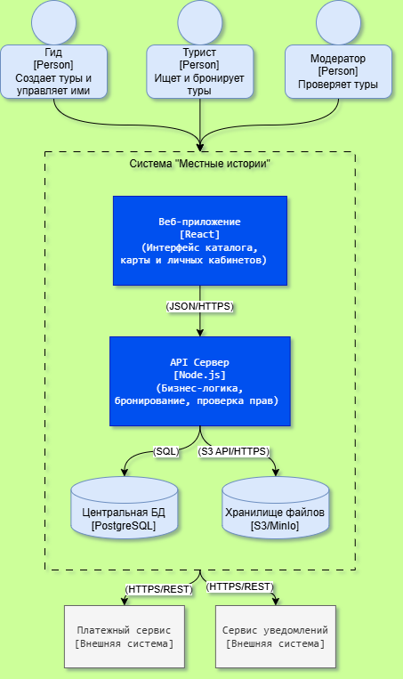

### 📄 Документ 5: `PZ_5.md` (Для проекта «Местные истории»)

# ПЗ №5. Диаграмма контейнеров С4

**Группа:** ЭФБО-14-25  
**Команда:** ДенДанРо  
**Дата:** 23.10.2026

## Бланк 1. Окружение с контекстной диаграммы

| Элемент                | Тип: человек / внешняя система | Описание (как на контекстной диаграмме)                                            |
| :--------------------- | :----------------------------- | :--------------------------------------------------------------------------------- |
| **Гид**                | Человек                        | Локальный гид, создает туры и управляет ими, настраивает Story Trail и расписание. |
| **Турист**             | Человек                        | Человек, ищущий и бронирующий туры, проходящий Story Trail.                        |
| **Модератор**          | Человек                        | Проверяет публикуемые туры и следит за работой сервиса.                            |
| **Платежный сервис**   | Внешняя система                | Сервис платежей (тестовый режим), принимает запросы на оплату.                     |
| **Сервис уведомлений** | Внешняя система                | Доставка уведомлений пользователям на сайт и на email.                             |

### Связи с контекстной диаграммы

| № связи | От               | К                  | Подпись                                                                 | Use Case           |
| :------ | :--------------- | :----------------- | :---------------------------------------------------------------------- | :----------------- |
| К1      | Гид              | Система            | Создаёт тур, настраивает Story Trail и расписание                       | UC2, UC4, UC8      |
| К2      | Турист           | Система            | Ищет и бронирует тур, оплачивает, проходит Story Trail, оставляет отзыв | UC1, UC3, UC5, UC7 |
| К3      | Модератор        | Система            | Проверяет опубликованные туры                                           | UC6                |
| К4      | Система          | Платежный сервис   | Отправляет запрос на оплату                                             | UC3                |
| К5      | Платежный сервис | Система            | Возвращает результат транзакции                                         | UC3                |
| К6      | Система          | Сервис уведомлений | Отправляет уведомления туристу и гиду                                   | UC1, UC2           |

---

## Бланк 2. Контейнеры

| Вопрос                                                                            | Ответ                                                                              |
| :-------------------------------------------------------------------------------- | :--------------------------------------------------------------------------------- |
| **1. Через что работает с системой каждый человек?**                              | Гид, турист и модератор работают через единое Веб-приложение (SPA в браузере).     |
| **2. Что принимает запросы, проверяет права и выполняет правила продукта?**       | API Сервер (Backend). Он проверяет роли, бронирует слоты и инициирует оплату.      |
| **3. Где хранятся данные, которые должны сохраниться после закрытия приложения?** | В Центральной БД (PostgreSQL) и в Хранилище файлов (S3-совместимое).               |
| **4. Есть ли работа, которую система делает без действия человека?**              | Да, API Сервер отправляет фоновые запросы в Платежный сервис и Сервис уведомлений. |

### Таблица контейнеров

| Контейнер (название) | Вид                     | Технология, предварительно             | Описание: что делает или хранит                                                                     | Кто работает или обращается | Откуда взялся        |
| :------------------- | :---------------------- | :------------------------------------- | :-------------------------------------------------------------------------------------------------- | :-------------------------- | :------------------- |
| **Веб-приложение**   | Приложение пользователя | React, предварительно                  | Интерфейс для всех ролей. Отображает каталог, карту, Story Trails, личные кабинеты.                 | Гид, Турист, Модератор      | UC1-UC8, Связи К1-К3 |
| **API Сервер**       | Серверное приложение    | Node.js, NestJS, предварительно        | Обрабатывает бизнес-логику, авторизацию, бронирование, формирует запросы к платежам и уведомлениям. | Веб-приложение              | Связи К4, К6         |
| **Центральная БД**   | Хранилище               | PostgreSQL, предварительно             | Хранит данные пользователей, туров, броней, отзывов и статусов.                                     | API Сервер                  | Новая                |
| **Хранилище файлов** | Хранилище               | S3-совместимое (MinIO), предварительно | Хранит медиафайлы: фото туров, аудио для Story Trails, аватары.                                     | API Сервер                  | Новая (для UC4)      |

---

## Бланк 3. Связи

| №   | От               | К                  | Подпись: что делает источник                                 | Технология, предварительно | Use Case           | Из связи |
| :-- | :--------------- | :----------------- | :----------------------------------------------------------- | :------------------------- | :----------------- | :------- |
| 1   | Гид              | Веб-приложение     | Создаёт туры, настраивает Story Trail и расписание           | —                          | UC2, UC4, UC8      | К1       |
| 2   | Турист           | Веб-приложение     | Ищет и бронирует туры, оплачивает, проходит Story Trail      | —                          | UC1, UC3, UC5, UC7 | К2       |
| 3   | Модератор        | Веб-приложение     | Проверяет опубликованные туры                                | —                          | UC6                | К3       |
| 4   | Веб-приложение   | API Сервер         | Отправляет запросы на бронирование, оплату, получение данных | JSON/HTTPS                 | UC1-UC8            | Новая    |
| 5   | API Сервер       | Центральная БД     | Читает и записывает данные о турах, бронях и пользователях   | SQL                        | UC1-UC8            | Новая    |
| 6   | API Сервер       | Хранилище файлов   | Загружает и получает фото/аудио файлы                        | S3 API / HTTPS             | UC4                | Новая    |
| 7   | API Сервер       | Платежный сервис   | Отправляет запрос на оплату                                  | HTTPS / REST               | UC3                | К4       |
| 8   | Платежный сервис | API Сервер         | Возвращает результат транзакции                              | HTTPS / REST               | UC3                | К5       |
| 9   | API Сервер       | Сервис уведомлений | Отправляет уведомления туристу и гиду                        | HTTPS / REST               | UC1, UC2           | К6       |

---

## Бланк 4. Требования к качеству и контейнеры

| Требование (ПЗ №3)                                 | Какие контейнеры затрагивает | Меняет ли диаграмму: нет / да                                     | Что относится к развёртыванию                          |
| :------------------------------------------------- | :--------------------------- | :---------------------------------------------------------------- | :----------------------------------------------------- |
| **НФТ 1: 100 одновременно активных пользователей** | API Сервер, Центральная БД   | Нет — архитектура уже поддерживает разделение нагрузки.           | Настройка пула соединений с БД и конфигурация сервера. |
| **НФТ 2: Защита от двойных броней**                | Центральная БД               | Нет — реализуется на уровне транзакций СУБД (EXCLUDE constraint). | Ничего дополнительно.                                  |
| **НФТ 3: Оплата в тестовом режиме**                | API Сервер, Платежный сервис | Нет — внешний сервис изолирован.                                  | Использование тестовых API-ключей в окружении.         |
| **НФТ 4: Безопасность и роли**                     | API Сервер, Веб-приложение   | Нет — проверка прав на API.                                       | Настройка CORS, JWT-секретов в .env.                   |

---

## Бланк 5. Диаграмма контейнеров

**Название диаграммы:** Диаграмма контейнеров системы «Местные истории»

### Легенда

| Обозначение                | Что означает                      |
| :------------------------- | :-------------------------------- |
| Синий человечек            | Человек (роль)                    |
| Темно-синий прямоугольник  | Контейнер системы                 |
| Цилиндр синий              | База данных / Хранилище           |
| Серый прямоугольник        | Внешняя программная система       |
| Рамка пунктиром            | Граница проектируемой системы     |
| Стрелка                    | Связь (от источника к получателю) |
| В скобках (предварительно) | Технология до ПЗ №8               |

---

## Бланк 5 (продолжение). Что не показано на диаграмме

| Что                                                | Почему не показано                                                                                           |
| :------------------------------------------------- | :----------------------------------------------------------------------------------------------------------- |
| **Физические серверы и хостинг**                   | Диаграмма контейнеров показывает логику, а не железо. Где именно запущен Docker — это уровень развертывания. |
| **Количество экземпляров (масштабирование)**       | Для MVP достаточно одного экземпляра API и одной БД. Балансировщики нагрузки не требуются.                   |
| **Модули внутри приложений (UI-слой, компоненты)** | Это внутренняя архитектура кода, она не влияет на взаимодействие систем между собой.                         |
| **Таблицы базы данных (users, tours)**             | Контейнер «Центральная БД» показан как единое хранилище. Структура таблиц описывается в ER-диаграмме.        |

---

## Бланк 6. Сверка

| Проверка                                                           | До проверки | Что исправлено                                 | Итог |
| :----------------------------------------------------------------- | :---------- | :--------------------------------------------- | :--- |
| 1. Люди и внешние системы совпадают с контекстной диаграммой       | Да          | Все элементы перенесены (ПЗ №4).               | Да   |
| 2. Каждая связь контекстной диаграммы отражена                     | Да          | Добавлены связи через Веб-приложение и API.    | Да   |
| 3. Каждый Use Case проходится по стрелкам                          | Да          | Путь от человека до БД и обратно работает.     | Да   |
| 4. Приложения пользователей не обращаются к БД напрямую            | Да          | Веб-приложение общается только с API Сервером. | Да   |
| 5. Нет устройств, серверов, экземпляров, модулей                   | Да          | Внутри границы только 4 контейнера.            | Да   |
| 6. У контейнеров есть технологии «предварительно», связи подписаны | Да          | Добавлены [JSON/HTTPS, SQL, S3 API].           | Да   |
| 7. У диаграммы есть название, граница и легенда                    | Да          | Оформлено.                                     | Да   |

---

## Бланк 7. Проверка читаемости

Авторы вписывают в первый столбец названия двух Use Case и передают читателям диаграмму и этот бланк. Команда-читатель заполняет второй столбец по одной диаграмме, без пояснений авторов. Два последних столбца заполняют авторы после того, как читатели вернут бланк.

**Команда-читатель:** «PETSWALK»

| Use Case (вписывают авторы)     | Ответ читателей (по диаграмме)                                                                                                                                                                                                                                                                                                                                                                                                         | Совпадает с замыслом авторов? | Что авторы исправили                                                                                                                                                                          |
| :------------------------------ | :------------------------------------------------------------------------------------------------------------------------------------------------------------------------------------------------------------------------------------------------------------------------------------------------------------------------------------------------------------------------------------------------------------------------------------- | :---------------------------- | :-------------------------------------------------------------------------------------------------------------------------------------------------------------------------------------------- |
| **UC 1: Забронировать тур**     | 1. Турист начинает работу через Веб-приложение. 2. Веб-приложение отправляет запрос на бронирование в API Сервер (JSON/HTTPS). 3. API Сервер проверяет доступность слота в Центральной БД (SQL). 4. API Сервер отправляет запрос на оплату в Платежный сервис (HTTPS/REST). 5. Платежный сервис возвращает результат. 6. API Сервер сохраняет бронь в Центральную БД и отправляет уведомление через Сервис уведомлений. | Да                            | -                                                                                                                                                                                             |
| **UC 4: Настроить Story Trail** | 1. Гид работает в Веб-приложении. 2. Веб-приложение отправляет данные о точках маршрута в API Сервер. 3. API Сервер сохраняет медиафайлы (фото/аудио) в Хранилище файлов (S3 API). 4. API Сервер сохраняет текстовые данные и координаты точек в Центральную БД (SQL).                                                                                                                                                        | Да                            | -                                                                                                                                                                                             |
| **Что осталось непонятным?**    | Понятно ли, откуда берутся координаты для карты, если на диаграмме нет отдельного контейнера картографического сервиса?                                                                                                                                                                                                                                                                                                                | Да                            | Добавили в описание API Сервера уточнение: «формирует запросы к платежам, уведомлениям и картографическому сервису» (или оставили как есть, так как карта — это часть фронтенда/внешний вид). |
