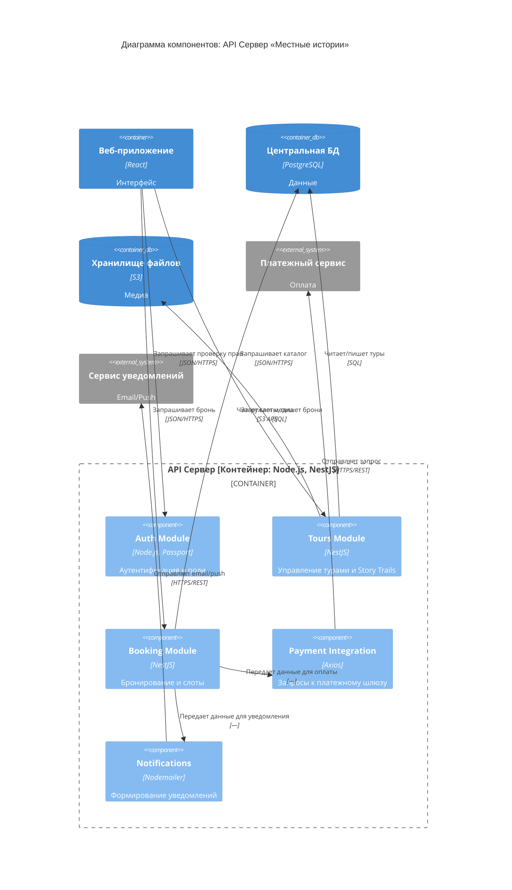

### 📄 Документ 6: `PZ_6.md` (Диаграмма компонентов)

# ПЗ №6. Диаграмма компонентов С4

**Группа:** ЭФБО-14-25  
**Команда:** ДенДанРо  
**Дата:** 30.10.2026

## Бланк 1. Выбранный контейнер и его связи

| Поле                         | Значение                                                                                                                         |
| :--------------------------- | :------------------------------------------------------------------------------------------------------------------------------- |
| **Детализируемый контейнер** | API Сервер                                                                                                                       |
| **Тип и технология**         | [Контейнер: Node.js, NestJS, предварительно]                                                                                     |
| **Описание**                 | Обрабатывает бизнес-логику, авторизацию, бронирование, формирует запросы к платежам, уведомлениям и медиафайлам.                 |
| **Почему выбран**            | Здесь выполняются все ключевые правила продукта (бронирование без овербукинга, роли, платежи). Через него проходят все Use Case. |

### Связи контейнера (с диаграммы контейнеров ПЗ №5)

| № связи | От               | К                  | Подпись                                                      | Технология                     | Use Case |
| :------ | :--------------- | :----------------- | :----------------------------------------------------------- | :----------------------------- | :------- |
| С4      | Веб-приложение   | API Сервер         | Отправляет запросы на бронирование, оплату, получение данных | JSON/HTTPS, предварительно     | UC1-UC8  |
| С5      | API Сервер       | Центральная БД     | Читает и записывает данные о турах, бронях и пользователях   | SQL, предварительно            | UC1-UC8  |
| С6      | API Сервер       | Хранилище файлов   | Загружает и получает фото/аудио файлы                        | S3 API / HTTPS, предварительно | UC4      |
| С7      | API Сервер       | Платежный сервис   | Отправляет запрос на оплату                                  | HTTPS / REST, предварительно   | UC3      |
| С8      | Платежный сервис | API Сервер         | Возвращает результат транзакции                              | HTTPS / REST, предварительно   | UC3      |
| С9      | API Сервер       | Сервис уведомлений | Отправляет уведомления туристу и гиду                        | HTTPS / REST, предварительно   | UC1, UC2 |

---

## Бланк 2. Компоненты

**Ответы на вопросы поиска компонентов:**

| Вопрос                                                 | Ответ                                                                                                              |
| :----------------------------------------------------- | :----------------------------------------------------------------------------------------------------------------- |
| **1. Что принимает запросы?**                          | Все запросы от Веб-приложения принимает единый шлюз API (контроллеры), который маршрутизирует их к нужным модулям. |
| **2. Какие правила выполняет?**                        | Управление контентом (туры, Story Trails), Бронирование (проверка слотов), Оплата, Уведомления.                    |
| **3. Кто проверяет вход и права?**                     | Модуль аутентификации (проверка JWT, роли Гид/Турист/Модератор).                                                   |
| **4. Кто обращается к хранилищам и внешним системам?** | Модуль туров (к БД и файлам), Модуль бронирования (к БД и платежам), Модуль уведомлений (к внешнему сервису).      |

**Таблица компонентов:**

| Компонент (название)    | Технология, предварительно           | Ответственность                                                          | Интерфейс                                            | Откуда взялся     |
| :---------------------- | :----------------------------------- | :----------------------------------------------------------------------- | :--------------------------------------------------- | :---------------- |
| **Auth Module**         | Node.js, Passport.js, предварительно | Регистрация, вход, выдача JWT, проверка ролей.                           | Проверить токен; выдать токен; проверить права.      | С4, UC1-UC8       |
| **Tours Module**        | Node.js, NestJS, предварительно      | CRUD туров, управление Story Trail (точки, медиа).                       | Создать/изменить тур; добавить точку; получить тур.  | С4, UC2, UC4, UC8 |
| **Booking Module**      | Node.js, NestJS, предварительно      | Управление слотами, проверка пересечений (овербукинга), создание броней. | Забронировать слот; отменить; проверить доступность. | С4, UC1, UC8      |
| **Payment Integration** | Node.js, Axios, предварительно       | Формирование запросов к платежному шлюзу и обработка вебхуков.           | Инициировать оплату; принять статус оплаты.          | С7, С8, UC3       |
| **Notifications**       | Node.js, Nodemailer, предварительно  | Формирование текста уведомлений и передача их во внешний сервис.         | Отправить уведомление (кому, что).                   | С9, UC1, UC2      |

---

## Бланк 3. Связи

| №   | От                  | К                   | Подпись: что делает источник                 | Технология                     | Use Case | Из связи |
| :-- | :------------------ | :------------------ | :------------------------------------------- | :----------------------------- | :------- | :------- |
| 1   | Веб-приложение      | Auth Module         | Запрашивает проверку токена и прав           | JSON/HTTPS, предварительно     | UC1-UC8  | С4       |
| 2   | Веб-приложение      | Tours Module        | Запрашивает каталог, передает данные тура    | JSON/HTTPS, предварительно     | UC2, UC4 | С4       |
| 3   | Веб-приложение      | Booking Module      | Передает запрос на бронь, запрашивает статус | JSON/HTTPS, предварительно     | UC1, UC3 | С4       |
| 4   | Booking Module      | Payment Integration | Передает данные для инициализации оплаты     | —                              | UC3      | Новая    |
| 5   | Tours Module        | Центральная БД      | Читает и записывает данные туров и точек     | SQL, предварительно            | UC2, UC4 | С5       |
| 6   | Booking Module      | Центральная БД      | Читает слоты, записывает брони               | SQL, предварительно            | UC1, UC3 | С5       |
| 7   | Tours Module        | Хранилище файлов    | Загружает и получает фото/аудио              | S3 API / HTTPS, предварительно | UC4      | С6       |
| 8   | Payment Integration | Платежный сервис    | Отправляет запрос на оплату                  | HTTPS / REST, предварительно   | UC3      | С7       |
| 9   | Payment Integration | Booking Module      | Передает успешный статус оплаты              | —                              | UC3      | Новая    |
| 10  | Booking Module      | Notifications       | Передает данные для уведомления о брони      | —                              | UC1      | Новая    |
| 11  | Notifications       | Сервис уведомлений  | Отправляет email/push                        | HTTPS / REST, предварительно   | UC1, UC2 | С9       |

---

## Бланк 4. Требования к качеству и типовые изменения

| Требование                   | Какой компонент отвечает | Меняет ли разбиение                                          | Что не видно на диаграмме                                   |
| :--------------------------- | :----------------------- | :----------------------------------------------------------- | :---------------------------------------------------------- |
| **Защита от двойных броней** | Booking Module           | Нет. Вся логика проверки слотов сосредоточена в одном месте. | Транзакции БД (EXCLUDE constraint) — решается на уровне БД. |
| **Роли (Гид/Турист/Админ)**  | Auth Module              | Нет. Проверка токена и ролей изолирована.                    | Настройка секретов JWT.                                     |

| Типовое изменение                                           | Какие компоненты затронет | Сколько | Вывод                                                                          |
| :---------------------------------------------------------- | :------------------------ | :------ | :----------------------------------------------------------------------------- |
| Смена платежного провайдера (например, со Stripe на ЮKassa) | Payment Integration       | 1       | Изоляция платежей в одном модуле позволяет легко сменить провайдера.           |
| Добавление SMS-уведомлений                                  | Notifications             | 1       | Модуль уведомлений просто начнет формировать другой запрос к внешнему сервису. |

---

## Бланк 5. Диаграмма компонентов

_(Визуализация схемы)_

### Легенда

| Обозначение            | Что означает                       |
| :--------------------- | :--------------------------------- |
| Синий блок             | Компонент контейнера               |
| Прямоугольник с рамкой | Граница детализируемого контейнера |
| Серый блок             | Внешняя система                    |
| Цилиндр                | База данных / Хранилище            |

---

## Бланк 5 (продолжение). Что не показано на диаграмме

| Что                           | Почему не показано                                                    |
| :---------------------------- | :-------------------------------------------------------------------- |
| **Классы и модели данных**    | Внутренний код (ПЗ №7).                                               |
| **Таблицы БД**                | Модель данных (ПЗ №7).                                                |
| **Фреймворк NestJS**          | Это технологический стек, указанный в квадратных скобках компонентов. |
| **Внутренние вызовы функций** | Не являются связями между компонентами.                               |

---

## Бланк 6. Сверка

| Проверка                             | До проверки | Что исправлено                                             | Итог |
| :----------------------------------- | :---------- | :--------------------------------------------------------- | :--- |
| 1. Все связи отражены                | Нет         | Добавлены связи от Web App к модулям Auth, Tours, Booking. | Да   |
| 2. Снаружи только напрямую связанные | Да          | —                                                          | Да   |
| 3. Обязанности распределены          | Да          | —                                                          | Да   |
| 4. Use Case проходятся по стрелкам   | Нет         | Добавлена связь Payment -> Booking для возврата статуса.   | Да   |
| 5. У каждого компонента есть связь   | Да          | —                                                          | Да   |
| 6. Нет классов/таблиц                | Да          | —                                                          | Да   |
| 7. Подписи и технологии корректны    | Да          | —                                                          | Да   |
| 8. Название, граница, легенда        | Да          | —                                                          | Да   |

---

## Бланк 7. Проверка соседней командой

**Команда-читатель:** «PETSWALK»

| Что проверяется                      | Ответ читателей                                                                                                                                                             | Совпадает? | Что исправили                                                      |
| :----------------------------------- | :-------------------------------------------------------------------------------------------------------------------------------------------------------------------------- | :--------- | :----------------------------------------------------------------- |
| **Use Case UC 1: Забронировать тур** | Начинается в Booking Module. Он берет данные из БД, затем передает данные в Payment Integration. Если оплата успешна, возвращает статус в Booking и вызывает Notifications. | Да         | —                                                                  |
| **Изменение: Добавление отзывов**    | Затронет Tours Module (добавление логики отзывов) и БД.                                                                                                                     | Частично   | Добавили в описание Tours Module уточнение «управление отзывами».  |
| **Что осталось непонятным?**         | Где проверяется, что слот свободен?                                                                                                                                         | —          | Это описано в ответственности Booking Module. Диаграмму не меняли. |
