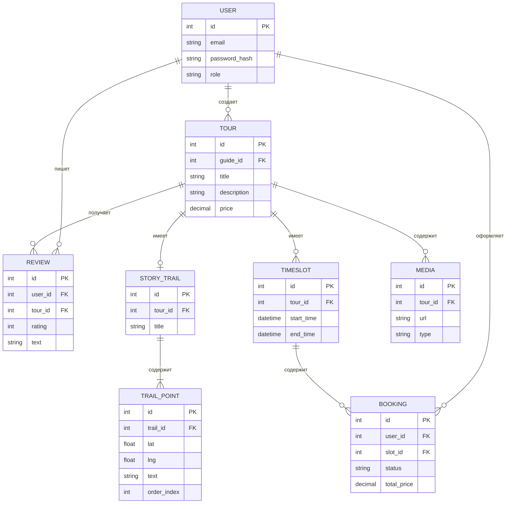

### 📄 Документ 7: `PZ_7.md` (Первичная модель данных)

# ПЗ №7. Первичная модель данных

**Группа:** ЭФБО-14-25  
**Команда:** ДенДанРо  
**Дата:** 30.10.2026

## Бланк 1. Кандидаты в сущности

| Кандидат               | Откуда                        | Решение  | Почему                                                        |
| :--------------------- | :---------------------------- | :------- | :------------------------------------------------------------ |
| **Тур**                | Задание ПЗ №7, хранилище, UC2 | Сущность | Имеет название, описание, цену. С ним связаны слоты и отзывы. |
| **Гид (Пользователь)** | UC2, UC4                      | Сущность | Нужно различать аккаунты, хранить email, пароль, роль.        |
| **Story Trail**        | Описание хранилища, UC4       | Сущность | Привязан к туру, имеет название и точки.                      |
| **Точка маршрута**     | UC4                           | Сущность | Имеет координаты, текст, порядковый номер.                    |
| **Слот (время)**       | UC1, UC8                      | Сущность | Имеет дату, время начала и конца, привязан к туру.            |
| **Бронь**              | UC1, UC3                      | Сущность | Связывает туриста и слот, имеет статус и сумму.               |
| **Отзыв**              | UC5                           | Сущность | Содержит текст, оценку, привязан к туру и туристу.            |
| **Статус брони**       | UC1, UC3                      | Атрибут  | Одно значение из списка (ожидает, оплачено, отменено).        |
| **Роль пользователя**  | НФТ (безопасность)            | Атрибут  | Строковое значение (guide, tourist, moderator).               |
| **Медиафайл**          | UC4                           | Сущность | Хранит ссылку на S3, тип файла (фото/аудио), привязку к туру. |

---

## Бланк 2. Сущности

**Хранилище:** Центральная БД (PostgreSQL)

| Сущность           | Описание                             | Идентификатор (PK) | Ключевые атрибуты                              | Компонент-владелец | Use Case |
| :----------------- | :----------------------------------- | :----------------- | :--------------------------------------------- | :----------------- | :------- |
| **Пользователь**   | Аккаунт гида, туриста или модератора | ID пользователя    | Email, хэш пароля, имя, роль                   | Auth Module        | UC1-UC8  |
| **Тур**            | Предложение гида                     | ID тура            | Название, описание, цена, статус (опубликован) | Tours Module       | UC2, UC4 |
| **Story Trail**    | Интерактивный маршрут тура           | ID трейла          | Название, описание                             | Tours Module       | UC4      |
| **Точка маршрута** | Точка на карте в Story Trail         | ID точки           | Широта, долгота, текст, порядок                | Tours Module       | UC4      |
| **Слот**           | Время, доступное для брони           | ID слота           | Дата, время начала, время конца                | Booking Module     | UC1, UC8 |
| **Бронь**          | Заказ туристом слота                 | ID брони           | Статус, общая сумма, время создания            | Booking Module     | UC1, UC3 |
| **Отзыв**          | Оценка тура туристом                 | ID отзыва          | Оценка (1-5), текст, дата                      | Tours Module       | UC5      |
| **Медиафайл**      | Фото или аудио для тура/точки        | ID файла           | URL в S3, тип (фото/аудио)                     | Tours Module       | UC4      |

---

## Бланк 3. Связи

| №   | Первая сущность       | Подпись   | Вторая сущность | Кратность у первой | Кратность у второй | Чтение в обе стороны                                                         | Откуда | M:N свои сведения? |
| :-- | :-------------------- | :-------- | :-------------- | :----------------- | :----------------- | :--------------------------------------------------------------------------- | :----- | :----------------- |
| 1   | Пользователь (Гид)    | создает   | Тур             | 1..N               | 1                  | Один гид создает много туров; каждый тур создан одним гидом.                 | UC2    | —                  |
| 2   | Тур                   | имеет     | Story Trail     | 0..1               | 1                  | У тура есть ноль или один Story Trail; каждый трейл принадлежит одному туру. | UC4    | —                  |
| 3   | Story Trail           | содержит  | Точка маршрута  | 1..N               | 1                  | Трейл содержит много точек; каждая точка принадлежит одному трейлу.          | UC4    | —                  |
| 4   | Тур                   | имеет     | Слот            | 0..N               | 1                  | У тура много слотов; каждый слот принадлежит одному туру.                    | UC1    | —                  |
| 5   | Пользователь (Турист) | оформляет | Бронь           | 0..N               | 1                  | Турист оформляет много броней; каждая бронь оформлена одним туристом.        | UC1    | —                  |
| 6   | Слот                  | содержит  | Бронь           | 0..N               | 1                  | Слот содержит много броней; каждая бронь относится к одному слоту.           | UC1    | —                  |
| 7   | Тур                   | имеет     | Отзыв           | 0..N               | 1                  | Тур имеет много отзывов; каждый отзыв относится к одному туру.               | UC5    | —                  |
| 8   | Пользователь (Турист) | пишет     | Отзыв           | 0..N               | 1                  | Турист пишет много отзывов; каждый отзыв написан одним туристом.             | UC5    | —                  |
| 9   | Тур                   | содержит  | Медиафайл       | 0..N               | 1                  | Тур содержит много медиа; каждый файл привязан к одному туру.                | UC4    | —                  |

---

## Бланк 4. Правила данных

| №   | Правило                                                      | Сущности и атрибуты    | Вид правила         | Откуда       | Операция, которая может нарушить     | Что нужно от хранилища               |
| :-- | :----------------------------------------------------------- | :--------------------- | :------------------ | :----------- | :----------------------------------- | :----------------------------------- |
| П1  | Email пользователя не повторяется                            | Пользователь: email    | Уникальность        | НФТ (Auth)   | Регистрация                          | Строгая согласованность              |
| П2  | На один слот не может быть двух успешных броней (овербукинг) | Бронь: слот_id, статус | Несколько записей   | НФТ (Бизнес) | Одновременная оплата двумя туристами | Строгая согласованность (транзакции) |
| П3  | Статус брони — только из списка (pending, paid, cancelled)   | Бронь: статус          | Допустимые значения | UC3          | Смена статуса                        | Строгая согласованность              |
| П4  | Оценка в отзыве от 1 до 5                                    | Отзыв: оценка          | Допустимые значения | UC5          | Создание отзыва                      | Строгая согласованность              |
| П5  | У каждого тура есть гид (создатель)                          | Тур: guide_id          | Обязательная связь  | UC2          | Удаление гида                        | Строгая согласованность              |

---

## Бланк 5. ER-диаграмма

**Название диаграммы:** Первичная модель данных: Центральная БД платформы «Местные истории»

_(Визуализация ER-диаграммы)_

### Легенда

| Обозначение | Что означает                 |
| :---------- | :--------------------------- |
| `PK`        | Первичный ключ (Primary Key) |
| `FK`        | Внешний ключ (Foreign Key)   |
| `--o{`      | Один ко многим (0 или много) |
| `--o`       | Один к одному (0 или один)   |
| `--`        | Один ко многим (1 или много) |

**Правила данных (из Бланка 4):**

- П1: Email пользователя уникален.
- П2: На один слот не может быть двух успешных броней.
- П3: Статус брони: pending, paid, cancelled.
- П4: Оценка от 1 до 5.
- П5: У тура обязательно есть гид.

**Что не вошло в модель:**

- **Файлы (картинки/аудио) физически:** хранятся в S3, в БД только ссылки (сущность MEDIA).
- **Данные платежной карты:** не хранятся в системе (PCI DSS), обрабатываются на стороне платежного сервиса.
- **Логи и аналитика:** вынесены в отдельные сервисы, не входят в оперативную БД.

---

## Бланк 6. Сверка

| Проверка                                   | До проверки | Что исправлено | Итог |
| :----------------------------------------- | :---------- | :------------- | :--- |
| 1. Все виды данных учтены                  | Да          | —              | Да   |
| 2. Ключевые Use Case проходятся по модели  | Да          | —              | Да   |
| 3. У каждой сущности есть PK и владелец    | Да          | —              | Да   |
| 4. Владелец связан с хранилищем            | Да          | —              | Да   |
| 5. У каждой связи есть подпись и кратность | Да          | —              | Да   |
| 6. Нет M:N с собственными сведениями       | Да          | —              | Да   |
| 7. Правила данных привязаны к сущностям    | Да          | —              | Да   |
| 8. Нет действий, экранов, контейнеров      | Да          | —              | Да   |

---

## Бланк 7. Проверка соседней командой

**Команда-читатель:** «PETSWALK»

| Вопрос авторов                                          | Ответ читателей                            | Совпадает? | Что исправили                                                       |
| :------------------------------------------------------ | :----------------------------------------- | :--------- | :------------------------------------------------------------------ |
| **Может ли тур существовать без слота?**                | Да, на связи TOUR-TIMESLOT стоит `0..N`.   | Да         | —                                                                   |
| **Может ли одна бронь относиться к нескольким слотам?** | Нет, у BOOKING есть только один `slot_id`. | Да         | —                                                                   |
| **Где хранится оценка отзыва?**                         | В сущности REVIEW, атрибут rating.         | Да         | —                                                                   |
| **Что осталось непонятным?**                            | Почему у TOUR связь с STORY_TRAIL `0..1`?  | —          | Потому что тур может быть без трейла (черновик). Оставили как есть. |
