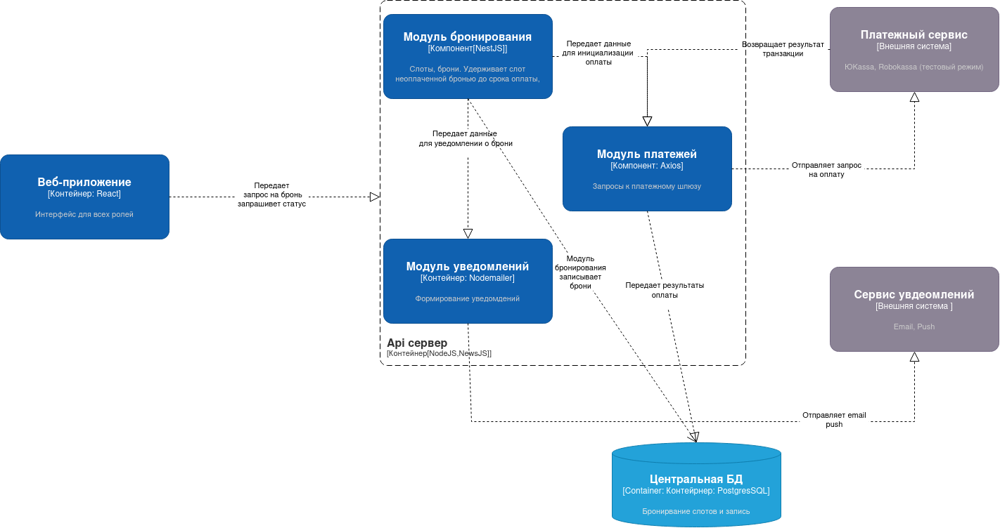

# ПЗ №9. Выбор архитектурного подхода

**Группа:** ЭФБО-14-25  
**Команда:** ДенДанРо  
**Дата:** дд.мм.2026

**Входные документы:** ПЗ №3 (Use Case, отклонения, НФТ1–НФТ5), ПЗ №5 (Контейнеры), ПЗ №6 (Компоненты), ПЗ №7 (Модель данных, правила П1–П5), ПЗ №8 (Выбор стека).

---

## Бланк 1. Вопрос решения

| Поле                                                       | Содержание                                                                                                                                                                                                                                                                                                                                                                                                                                                              |
| :--------------------------------------------------------- | :---------------------------------------------------------------------------------------------------------------------------------------------------------------------------------------------------------------------------------------------------------------------------------------------------------------------------------------------------------------------------------------------------------------------------------------------------------------------- |
| **Вопрос решения**                                         | Каким способом система гарантирует правило П2 («на один слот не может быть двух успешных броней») при одновременном бронировании, если оплата проходит во внешнем платёжном сервисе и между выбором слота и подтверждением оплаты проходит время?                                                                                                                                                                                                                       |
| **Почему решение архитектурно значимо: на что оно влияет** | Определяет, в какой момент слот закрепляется за туристом (до оплаты или после), какой компонент и в каком порядке меняет бронь, что хранится в модели данных (статус, срок удержания), как Payment Integration и Booking Module обмениваются результатом оплаты. От него зависит, что увидит второй турист при одновременной записи (UC1, отклонение 4а) и что происходит со слотом, если оплата не прошла (UC1, гарантированный результат; отклонения 7а, 8а).         |
| **Связанные Use Case, НФТ, правила данных**                | П2 (ПЗ №7): «На один слот не может быть двух успешных броней (овербукинг)»; НФТ2 (ПЗ №3): «На один слот система принимает не больше одной брони. Если два туриста одновременно пытаются занять слот, бронь создается только для одного»; П3: статус брони — pending, paid, cancelled; UC1 «Забронировать тур», шаги 4, 6–8, гарантированный результат, отклонения 4а, 7а, 8а; UC3 «Оплатить бронь»; НФТ5 (оплата только в тестовом режиме).                             |
| **Что уже решено раньше и не пересматривается (документ)** | Одно серверное приложение «API Сервер» и одна «Центральная БД» (ПЗ №5). Центральная БД — PostgreSQL, сравнение с SQLite выполнено (ПЗ №8, бланк 5). Бронирование выполняет Booking Module, оплату — Payment Integration, уведомления — Notifications (ПЗ №6). Владелец сущностей «Слот» и «Бронь» — Booking Module (ПЗ №7, бланк 2). Платёжный сервис — Stripe в тестовом режиме (ПЗ №8, бланк 1). Статусы брони — pending, paid, cancelled (П3).                       |
| **Чего это решение не решает**                             | 1) Пересечение слотов одного гида по времени (механизм EXCLUDE по диапазонам из ПЗ №8, бланк 4, часть В защищает именно это, а не П2; отдельного правила данных для пересечения слотов нет — вопрос к перечню правил). 2) Удаление тура или слота, на который есть брони (hard / soft delete — вопрос заказчику из ПЗ №8). 3) Отмена оплаченной брони туристом и возврат денег. 4) Перевод денег гиду (вне границ MVP, ПЗ №4). 5) Выбор поставщика сервиса уведомлений. |
| **Вопросы заказчику без ответа и допущение до ответа**     | 1) Сколько времени неоплаченная бронь может удерживать слот? Допущение: 30 минут (минимальный срок жизни сессии оплаты Stripe Checkout, [И5]). 2) Может ли на один слот записаться несколько туристов (групповой тур с вместимостью)? Допущение: один слот — одна бронь, как записано в П2 и НФТ2.                                                                                                                                                                      |
| **Другие открытые вопросы проекта (одной строкой каждый)** | Значение порога p95 в НФТ1 не установлено (в ПЗ №3 записано «p95 времени ответа <= 1%»); hard или soft delete тура с бронями (ПЗ №8); комиссия платформы (ПЗ №8: для MVP 0%); поставщик Email-сервиса не назван (ПЗ №8); откуда берутся координаты точек Story Trail — на диаграммах нет картографического сервиса (ПЗ №5, бланк 7).                                                                                                                                    |

### Операции, по которым проверяют варианты

| №      | Операция или сценарий                                                                  | Use Case, шаг                | Чем опасна: одновременная работа, сбой, недоступная система                                                                        |
| :----- | :------------------------------------------------------------------------------------- | :--------------------------- | :--------------------------------------------------------------------------------------------------------------------------------- |
| **О1** | Два туриста одновременно бронируют один и тот же свободный слот                        | UC1, шаг 4; отклонение 4а    | Одновременная работа: обе проверки «слот свободен» проходят раньше обеих записей — две брони на слот (нарушение П2, НФТ2)          |
| **О2** | Турист выбрал слот, перешёл к оплате и не оплатил (закрыл страницу, оплата отклонена)  | UC1, шаги 6–7; отклонение 7а | Сбой посередине: слот может остаться занятым неоплаченной бронью навсегда — гид теряет слот                                        |
| **О3** | Платёжный сервис недоступен при создании оплаты                                        | UC1, шаг 7; отклонение 8а    | Недоступная внешняя система: бронь создана, а оплатить её нельзя                                                                   |
| **О4** | Уведомление об успешной оплате приходит от платёжного сервиса повторно или с задержкой | UC1, шаг 8; UC3              | Внешняя система: повторная доставка события может второй раз изменить бронь; поздняя доставка — после того как слот уже освобождён |

---

## Бланк 2. Требования и приоритеты

Вид: О — обязательное условие, К — критерий. Приоритет ставят только критериям: 1 — самый важный.

| №      | Требование                                                                                                                                                                | Источник                                                                                                                                                                                | Вид | Как проверить, что вариант его выполняет                                                                                        | Приоритет |
| :----- | :------------------------------------------------------------------------------------------------------------------------------------------------------------------------ | :-------------------------------------------------------------------------------------------------------------------------------------------------------------------------------------- | :-- | :------------------------------------------------------------------------------------------------------------------------------ | :-------- |
| **Т1** | П2 не нарушается ни в одной из операций О1–О4, в том числе одновременных                                                                                                  | П2 (ПЗ №7); НФТ2 (ПЗ №3); ПЗ №1, Бланк Б: «Не сокращаем никогда: бронирование»                                                                                                          | О   | Интеграционный тест из ПЗ №8 (бланк 4): два параллельных запроса на один слот — один 200, второй 409; проход операций О1–О4     | —         |
| **Т2** | Если оплата не прошла или платёжный сервис недоступен, слот снова свободен                                                                                                | UC1, гарантированный результат: «Если оплата не прошла — бронь не создается, слот остается свободным»; отклонения 7а, 8а                                                                | О   | Тест с отклонённой оплатой и с недоступным платёжным сервисом (тестовый режим): после него слот можно забронировать             | —         |
| **Т3** | При одновременной записи второй турист получает определённый ответ «Этот слот уже занят, выберите другое время» на шаге выбора слота, а не ошибку и не отказ после оплаты | UC1, отклонение 4а; ПЗ №8, бланк 7 (обработка ответа 409 в `frontend/src/lib/api.ts`)                                                                                                   | О   | Тот же тест, что у Т1: что возвращает API Сервер второму запросу и когда                                                        | —         |
| **Т4** | Турист не платит за слот, который ему не достанется: возвратов из-за занятого слота нет                                                                                   | UC1, шаг 4: «Проверяет, что слот свободен, и резервирует место» — до оплаты                                                                                                             | К   | Проход О1: есть ли путь, при котором второй турист оплачивает занятый слот                                                      | 1         |
| **Т5** | Правило защищено на уровне Центральной БД, а не только кодом API Сервера                                                                                                  | **Допущение команды**, опирается на вывод ПЗ №8, бланк 5: «гарантировать целостность на уровне БД без написания сложных блокировок в коде»; бэкенд пишет один участник (ПЗ №1, Бланк В) | К   | Сравнение варианта с моделью данных: есть ли ограничение схемы, которое отклонит вторую бронь, даже если в коде проверку забыли | 2         |
| **Т6** | Неоплаченная бронь не удерживает слот дольше срока оплаты                                                                                                                 | Интерес гида «заполнить слот» (ПЗ №3, бланк 4, заинтересованные стороны); UC8                                                                                                           | К   | Проход О2: через какое время слот снова доступен другим туристам                                                                | 3         |

**Почему приоритеты критериев расставлены так.** Т4 первым: платёж за занятый слот видит турист, а возврат денег — ручная работа, которую продукт как раз должен убрать (ПЗ №1: ручной учёт оплат — проблема заказчика; автоматические выплаты — вне MVP). Т5 вторым: бэкенд пишет один человек (Руслан), и на ПЗ №8 команда выбрала PostgreSQL именно ради защиты правила средствами БД. Т6 последним: срок удержания — допущение до ответа заказчика, и его можно поменять настройкой без смены способа.

---

## Бланк 3. Варианты

|                                                        | **Вариант А: удержание слота неоплаченной бронью + частичный уникальный индекс**                                                                                                                                                                                                                                                                                                                                     | **Вариант Б: слот закрепляется только после оплаты**                                                                                                                                                                                                                                  | **Вариант В: удержание слота + блокировка строки слота в коде**                                                                                                                                                          |
| :----------------------------------------------------- | :------------------------------------------------------------------------------------------------------------------------------------------------------------------------------------------------------------------------------------------------------------------------------------------------------------------------------------------------------------------------------------------------------------------- | :------------------------------------------------------------------------------------------------------------------------------------------------------------------------------------------------------------------------------------------------------------------------------------ | :----------------------------------------------------------------------------------------------------------------------------------------------------------------------------------------------------------------------- |
| **Суть**                                               | Booking Module в одной транзакции переводит истёкшие брони слота в cancelled и создаёт бронь pending со сроком удержания `expires_at` (30 мин). В схеме — частичный уникальный индекс по `slot_id` для броней в статусах pending и paid: вторую активную бронь база отклоняет сама. Затем Payment Integration создаёт сессию оплаты с тем же сроком. Подтверждение оплаты меняет pending → paid условным изменением. | Бронь создаётся pending и слот не занимает. Когда приходит подтверждение оплаты, Booking Module в транзакции блокирует строку слота (`SELECT … FOR UPDATE`) и проверяет, нет ли уже paid. Если есть — бронь переводится в cancelled, а Payment Integration запрашивает возврат денег. | Как А, но без ограничения в схеме: Booking Module блокирует строку слота (`SELECT … FOR UPDATE`), отдельным запросом проверяет, нет ли активной брони (paid или неистёкшей pending), и только после этого создаёт бронь. |
| **Что меняется на диаграмме контейнеров**              | Не меняется                                                                                                                                                                                                                                                                                                                                                                                                          | Не меняется                                                                                                                                                                                                                                                                           | Не меняется                                                                                                                                                                                                              |
| **Что меняется на диаграмме компонентов**              | Новая связь 12: Платежный сервис → Payment Integration (результат оплаты; на ПЗ №6 связь С8 не была детализирована). Уточняются ответственность Booking Module и подписи связей 4 и 9.                                                                                                                                                                                                                               | Новая связь 12, как у А. Связь 4 дополняется запросом возврата: Booking Module → Payment Integration «Запрашивает возврат оплаты».                                                                                                                                                    | Новая связь 12, как у А. Уточняется ответственность Booking Module.                                                                                                                                                      |
| **Что меняется в модели данных и структурах хранения** | Бронь: новые атрибуты `expires_at` (срок удержания) и `payment_session_id` (идентификатор сессии оплаты). Частичный уникальный индекс `bookings(slot_id) WHERE status IN ('pending','paid')`. Статусы П3 не меняются.                                                                                                                                                                                                | Бронь: `payment_session_id`. Новый статус не нужен; но для возврата нужен признак «возврат запрошен» — новое значение в П3 (`refunded`) или отдельный атрибут.                                                                                                                        | Бронь: `expires_at`, `payment_session_id`. Ограничений схемы не добавляется.                                                                                                                                             |
| **Что меняется в стеке и настройках**                  | Уровень изоляции по умолчанию — Read Committed [И3]. Частичный индекс задаётся SQL-миграцией (в `schema.prisma` частичные индексы — не подтверждено, см. [И7]). Stripe Checkout: `expires_at` сессии = срок удержания [И5].                                                                                                                                                                                          | Read Committed; `SELECT … FOR UPDATE` [И2]. Stripe: API возвратов (Refunds) в тестовом режиме — не подтверждено.                                                                                                                                                                      | Read Committed; `SELECT … FOR UPDATE` [И2]. Stripe Checkout: `expires_at` [И5].                                                                                                                                          |
| **Тактика, если есть**                                 | Тайм-аут (срок удержания); идемпотентная обработка повторного события                                                                                                                                                                                                                                                                                                                                                | Компенсирующее действие (возврат)                                                                                                                                                                                                                                                     | Тайм-аут (срок удержания); идемпотентная обработка повторного события                                                                                                                                                    |
| **Источники фактов: документация, версия, раздел**     | [И1], [И2], [И3], [И5], [И6], [И7]                                                                                                                                                                                                                                                                                                                                                                                   | [И2], [И3], [И6]                                                                                                                                                                                                                                                                      | [И2], [И3], [И5], [И6]                                                                                                                                                                                                   |

**Что одинаково у всех вариантов и войдёт в решение при любом выборе:**

- Результат оплаты приходит в систему от Платежного сервиса — на диаграмме компонентов нужна связь «Платежный сервис → Payment Integration» (связь 12). На ПЗ №6 контейнерная связь С8 «Платежный сервис → API Сервер» не была разложена на компоненты.
- Подтверждение оплаты обрабатывается идемпотентно: событие может прийти повторно [И6], поэтому изменение статуса выполняется условием «только если бронь ещё pending».
- Механизм `EXCLUDE` из ПЗ №8 (бланк 4, часть В: «запрет пересечения диапазонов времени для одного гида») не защищает П2: он запрещает пересечение слотов во времени, а не две брони на один слот. Находка записана в бланк 6.

---

## Бланк 4. Оценка вариантов

### Часть А. Проход операций

| Операция                                            | Вариант А: удержание + частичный уникальный индекс                                                                                                                                                                                                                                                                                                                           | Вариант Б: закрепление после оплаты                                                                                                                                                                                                                                                                                                  | Вариант В: удержание + блокировка строки слота                                                                                                         |
| :-------------------------------------------------- | :--------------------------------------------------------------------------------------------------------------------------------------------------------------------------------------------------------------------------------------------------------------------------------------------------------------------------------------------------------------------------- | :----------------------------------------------------------------------------------------------------------------------------------------------------------------------------------------------------------------------------------------------------------------------------------------------------------------------------------- | :----------------------------------------------------------------------------------------------------------------------------------------------------- |
| **О1.** Два одновременных бронирования одного слота | Обе транзакции вставляют бронь pending. Вторая вставка ждёт фиксации первой и получает нарушение уникальности [И1, И2 (разд. 64.5)]. Booking Module отвечает 409, Веб-приложение показывает «Этот слот уже занят, выберите другое время» и ближайшие свободные слоты (UC1, 4а). До оплаты второй турист не доходит.                                                          | Обе брони pending создаются, обоим туристам открывается оплата. Оба платят. Первое подтверждение блокирует слот и ставит paid; второе видит paid, бронь → cancelled, Payment Integration запрашивает возврат. Второй турист узнаёт об отказе после оплаты. **Нарушено Т3** (ответ не на шаге 4а, а после оплаты); Т4 не выполняется. | Вторая транзакция ждёт на блокировке строки слота, пока первая не зафиксируется; затем видит активную бронь и получает 409 — то же сообщение, что в А. |
| **О2.** Турист не оплатил                           | Бронь pending держит слот до `expires_at`. Сессия оплаты с тем же сроком истекает, оплатить её после срока нельзя [И5]. Следующий турист, выбравший слот, в своей транзакции сначала переводит истёкшую бронь в cancelled, потом вставляет свою. Каталог показывает слот свободным, если активной брони нет или её срок истёк. Слот освобождается не позже чем через 30 мин. | Слот не занят, другие туристы бронируют его сразу.                                                                                                                                                                                                                                                                                   | Как в А, но истёкшая бронь определяется проверкой в коде.                                                                                              |
| **О3.** Платёжный сервис недоступен                 | Payment Integration не смогла создать сессию оплаты → Booking Module в той же операции переводит бронь в cancelled, слот свободен. Турист видит «Оплата временно недоступна, попробуйте позже» (UC1, 8а).                                                                                                                                                                    | Бронь pending остаётся, слот не занят. Турист видит то же сообщение.                                                                                                                                                                                                                                                                 | Как в А.                                                                                                                                               |
| **О4.** Повторное или позднее подтверждение оплаты  | Повтор: `UPDATE … SET status='paid' WHERE id=… AND status='pending'` меняет 0 строк — событие игнорируется [И6]. Позднее (после истечения): сессия оплаты истекла одновременно с бронью, оплата невозможна [И5]; совпадение по времени «оплата в последнюю секунду» и «отмена истёкшей брони» — **не подтверждено** (см. часть Б).                                           | Повтор: бронь уже paid или cancelled — игнорируется. Позднее: обрабатывается как обычное подтверждение.                                                                                                                                                                                                                              | Как в А.                                                                                                                                               |

### Часть Б. Что даёт и чем оплачивается

| Вопрос                                                        | Вариант А                                                                                                                                                                                                                                                                                                                                      | Вариант Б                                                                                                                                                                 | Вариант В                                                                                                                                                                                                                       |
| :------------------------------------------------------------ | :--------------------------------------------------------------------------------------------------------------------------------------------------------------------------------------------------------------------------------------------------------------------------------------------------------------------------------------------- | :------------------------------------------------------------------------------------------------------------------------------------------------------------------------ | :------------------------------------------------------------------------------------------------------------------------------------------------------------------------------------------------------------------------------ |
| **Что выигрываем: по каким требованиям и на каком основании** | Т1–Т3 — проход О1–О4; Т4 — второй турист не доходит до оплаты (О1); Т5 — вторую активную бронь отклоняет Центральная БД, даже если в коде проверку забыли [И1]; Т6 — слот свободен не позже 30 мин (О2).                                                                                                                                       | Т6 лучше всех — слот вообще не удерживается (О2). Модель данных почти не меняется.                                                                                        | Т1–Т4, Т6 — как у А (проход О1–О4). Не нужна SQL-миграция с частичным индексом.                                                                                                                                                 |
| **Что теряем, чем платим**                                    | Слот занят до 30 мин, даже если турист ушёл. Частичный индекс — ручная SQL-миграция вне `schema.prisma` (новое место, где можно ошибиться при пересоздании БД). Два новых атрибута в «Брони». Сообщение об ошибке уникальности нужно перевести в ответ 409 — ещё одно место в Booking Module.                                                  | Нарушено обязательное условие Т3; турист платит за занятый слот (Т4); появляется возврат — новая операция, новый статус или атрибут, зависимость от API возвратов Stripe. | Правило держится только на коде (Т5 не выполнен): любая новая операция с бронями (ручное бронирование модератором, сид-скрипт, импорт) в обход функции Booking Module нарушит П2 незаметно. Брони на один слот ждут друг друга. |
| **Можно ли отменить позже и во что это обойдётся**            | Да: удалить индекс одной миграцией и перейти к В; атрибуты `expires_at`, `payment_session_id` нужны и в В. Переход к вместимости слота > 1 потребует замены индекса (условие пересмотра).                                                                                                                                                      | Да, но придётся убрать возвраты и добавить удержание — переписать Booking Module и Payment Integration.                                                                   | Да: добавить индекс миграцией и перейти к А.                                                                                                                                                                                    |
| **Что не подтверждено и как проверить**                       | 1) Поддержка частичных индексов в `schema.prisma` — не подтверждено, способ — SQL в миграции [И7]; проверить при первой миграции. 2) Гонка «оплата в последнюю секунду / отмена истёкшей брони» — проверить в тестовом режиме Stripe: сессия с `expires_at` через 30 мин, оплата у границы. 3) Перевод нарушения уникальности в 409 — тест О1. | API возвратов Stripe в тестовом режиме — не изучалось.                                                                                                                    | Время ожидания на блокировке при пике бронирований — нагрузочный тест НФТ1.                                                                                                                                                     |

**Вывод словами.** Вариант Б отбрасывается: в операции О1 второй турист узнаёт о занятом слоте только после оплаты — нарушено обязательное условие Т3 (UC1, отклонение 4а) и проигран главный критерий Т4. Варианты А и В выполняют все обязательные условия Т1–Т3 и одинаково ведут себя по Т4 и Т6. Различает их критерий Т5 (приоритет 2): в А вторую активную бронь отклоняет сама Центральная БД, в В — только код Booking Module. Выбираем А. Точка компромисса: ради страховки на уровне БД платим ручной SQL-миграцией и удержанием слота до 30 минут.

---

## Бланк 5. Запись архитектурного решения

### ADR-001. Слот удерживается неоплаченной бронью до срока оплаты; двойную бронь отклоняет частичный уникальный индекс в Центральной БД

| Раздел                                                              | Содержание                                                                                                                                                                                                                                                                                                                                                                                                                                                                                                                                                                                                                                                                                                                                                                                                                                                                                                                                                                                                                                                                                                                                                                                                             |
| :------------------------------------------------------------------ | :--------------------------------------------------------------------------------------------------------------------------------------------------------------------------------------------------------------------------------------------------------------------------------------------------------------------------------------------------------------------------------------------------------------------------------------------------------------------------------------------------------------------------------------------------------------------------------------------------------------------------------------------------------------------------------------------------------------------------------------------------------------------------------------------------------------------------------------------------------------------------------------------------------------------------------------------------------------------------------------------------------------------------------------------------------------------------------------------------------------------------------------------------------------------------------------------------------------------- |
| **Дата и статус**                                                   | дд.мм.2026. Статус: **принято**.                                                                                                                                                                                                                                                                                                                                                                                                                                                                                                                                                                                                                                                                                                                                                                                                                                                                                                                                                                                                                                                                                                                                                                                       |
| **Контекст**                                                        | Правило П2 (ПЗ №7): на один слот не может быть двух успешных броней; НФТ2 (ПЗ №3): если два туриста одновременно пытаются занять слот, бронь создаётся только для одного. По UC1 «Забронировать тур» система резервирует место на шаге 4, до оплаты, а при неуспешной оплате слот должен остаться свободным (гарантированный результат; отклонения 7а «оплата не прошла» и 8а «платёжный сервис недоступен»). Оплата проходит во внешнем Платежном сервисе — Stripe в тестовом режиме (ПЗ №8, НФТ5), результат приходит в систему отдельным событием, которое может прийти повторно. Система — один API Сервер (Node.js, NestJS) и одна Центральная БД PostgreSQL (ПЗ №5, ПЗ №8). Брони и слоты принадлежат компоненту Booking Module (ПЗ №7), оплатой занимается Payment Integration (ПЗ №6). Статусы брони — pending, paid, cancelled (П3). Механизм EXCLUDE из ПЗ №8 запрещает пересечение слотов во времени и П2 не защищает. Допущения до ответа заказчика: неоплаченная бронь держит слот 30 минут; на один слот — одна бронь (групповых броней нет). **Решение не определяет:** пересечение слотов одного гида; удаление тура или слота с бронями; отмену оплаченной брони и возврат денег; перевод денег гиду. |
| **Рассмотренные варианты и причина отказа от каждого невыбранного** | **А** — бронь pending удерживает слот до срока оплаты; вторую активную бронь отклоняет частичный уникальный индекс в Центральной БД. **Б** — слот закрепляется только после подтверждения оплаты, при конфликте — возврат денег; отвергнут: второй турист узнаёт о занятом слоте только после того, как заплатил, — это противоречит UC1, отклонение 4а («слот занят — предлагает ближайшие свободные слоты» на шаге выбора), и требует возвратов, которых нет в продукте. **В** — удержание, как в А, но проверка «нет ли активной брони» под блокировкой строки слота в коде, без ограничения в схеме; отвергнут: правило держится только на коде, и любая операция с бронями в обход функции Booking Module (ручное бронирование, сид-скрипт, импорт) нарушит П2 незаметно, а бэкенд пишет один участник команды.                                                                                                                                                                                                                                                                                                                                                                                                   |
| **Решение**                                                         | Мы защищаем П2 вариантом А. Booking Module в одной транзакции: (1) переводит в cancelled брони этого слота в статусе pending с истёкшим `expires_at`; (2) создаёт бронь pending с `expires_at` = текущее время + 30 мин. В Центральной БД действует частичный уникальный индекс по `slot_id` для броней в статусах pending и paid: если второй турист пытается занять тот же слот, вставка отклоняется, и Booking Module отвечает 409; Веб-приложение показывает «Этот слот уже занят, выберите другое время» и ближайшие свободные слоты. После фиксации брони Payment Integration создаёт сессию оплаты Stripe с тем же сроком жизни. Если сессию создать не удалось (Платежный сервис недоступен), Booking Module переводит бронь в cancelled, и слот свободен. Результат оплаты Платежный сервис передаёт в Payment Integration (новая связь 12 диаграммы компонентов), та — в Booking Module (связь 9), который меняет статус pending → paid только если бронь ещё pending: повторное событие ничего не меняет. Каталог и выбор слота считают слот свободным, если у него нет брони paid и нет брони pending с неистёкшим сроком. Отвечает за это Booking Module (Руслан).                                        |
| **Последствия: что становится лучше**                               | Две активные брони на слот не может создать ни одна операция, даже написанная в обход Booking Module: их отклонит Центральная БД. Второй турист получает ответ до оплаты и не платит за занятый слот. Неоплаченная бронь освобождает слот сама, без фонового процесса и без ручной работы гида. Набор статусов П3 не меняется.                                                                                                                                                                                                                                                                                                                                                                                                                                                                                                                                                                                                                                                                                                                                                                                                                                                                                         |
| **Последствия: что становится хуже или сложнее**                    | Слот недоступен другим туристам до 30 минут, даже если турист закрыл страницу оплаты. Частичный индекс задаётся вручную SQL-миграцией, а не в `schema.prisma`: при пересоздании схемы его легко потерять. В «Бронь» добавляются два атрибута. Ошибку уникальности нужно переводить в ответ 409 — ещё одно место, где можно ошибиться. Срок удержания и срок сессии оплаты должны совпадать — их задаёт одна настройка.                                                                                                                                                                                                                                                                                                                                                                                                                                                                                                                                                                                                                                                                                                                                                                                                 |
| **Что нужно сделать и что проверить**                               | Сделать: добавить в модель данных атрибуты `expires_at`, `payment_session_id` и частичный уникальный индекс; уточнить формулировку П2 и дать у неё ссылку на ADR-001; в документе о стеке заменить механизм EXCLUDE в части В бланка 4 ссылкой на ADR-001; добавить связь 12 на диаграмму компонентов; уточнить отклонения 7а и 8а UC1 (см. бланк 6). Проверить, когда появится код: интеграционный тест из ПЗ №8 — два параллельных запроса на один слот, ожидается один 200 и один 409; тест с истёкшей бронью — через 30 мин слот снова свободен; тест с повторной доставкой события об оплате; поддерживает ли Prisma частичный индекс в схеме или нужна SQL-миграция; поведение Stripe при оплате в последнюю секунду перед `expires_at`.                                                                                                                                                                                                                                                                                                                                                                                                                                                                         |
| **При каких условиях решение пересматривают**                       | Заказчик назовёт другой срок удержания, меньше 30 минут (минимум для сессии Stripe Checkout) — нужен иной механизм истечения; на слот разрешат несколько броней (групповой тур с вместимостью) — уникальный индекс не подойдёт; появится оплата в рассрочку или оплата на месте — бронь будет «успешной» без статуса paid; тест покажет, что при оплате на границе срока возможна оплаченная, но отменённая бронь.                                                                                                                                                                                                                                                                                                                                                                                                                                                                                                                                                                                                                                                                                                                                                                                                     |

---

## Бланк 6. Изменения в документах и сверка

| Документ                                                         | Что меняется                                                                                                                                                                                                                                                                                                                                                                                                                                                                                                                                                                                                                                             |
| :--------------------------------------------------------------- | :------------------------------------------------------------------------------------------------------------------------------------------------------------------------------------------------------------------------------------------------------------------------------------------------------------------------------------------------------------------------------------------------------------------------------------------------------------------------------------------------------------------------------------------------------------------------------------------------------------------------------------------------------- |
| **«Контейнеры системы» (ПЗ №5) и перечень «Что не показано»**    | Диаграмма не меняется: все три варианта оставляют состав контейнеров и связи прежними. В бланке 4 у строки «НФТ 2: Защита от двойных броней» текст «EXCLUDE constraint» заменяется ссылкой на ADR-001, в затрагиваемые контейнеры добавляется API Сервер (проверку и перевод в 409 выполняет Booking Module). В перечне «Что не показано» у строки «Количество экземпляров (масштабирование)» — ссылка на ADR-002 (см. ниже).                                                                                                                                                                                                                            |
| **«Компоненты контейнера» (ПЗ №6) и перечень «Что не показано»** | Новая связь 12: «Платежный сервис → Payment Integration», подпись «Возвращает результат транзакции», HTTPS / REST, UC3, из связи С8. Ответственность Booking Module дополнена: «удерживает слот неоплаченной бронью до срока оплаты; отменяет истёкшие брони; идемпотентно принимает статус оплаты». Подпись связи 4 дополнена: «… и срок удержания»; подпись связи 9: «Передает результат оплаты (повтор игнорируется)». В бланке 4 у «Защиты от двойных броней» — ссылка на ADR-001 вместо «EXCLUDE constraint». В перечне «Что не показано» строка «Транзакции БД (EXCLUDE constraint)» заменяется на «Частичный уникальный индекс броней — ADR-001». |
| **«Модель данных» (ПЗ №7) и дополнение (ПЗ №8)**                 | BOOKING: новые атрибуты `expires_at` (timestamptz) и `payment_session_id` (string). П2 уточнено: «На один слот не больше одной брони в статусе pending или paid; pending с истёкшим сроком переводится в cancelled до создания новой брони; способ защиты — ADR-001». ПЗ №8, бланк 4, часть Б: у таблицы `bookings` — частичный уникальный индекс `(slot_id) WHERE status IN ('pending','paid')`. Статусы П3 не меняются.                                                                                                                                                                                                                                |
| **«Выбор технологического стека» (ПЗ №8)**                       | Часть В бланка 4: механизм «EXCLUDE constraint … для одного гида» заменяется ссылкой на ADR-001 (EXCLUDE защищает пересечение слотов, а не П2). Добавляются условия: уровень изоляции — Read Committed; частичный индекс — SQL-миграцией; Stripe Checkout — срок жизни сессии равен сроку удержания брони (30 мин). Расхождение: в ПЗ №8 — PostgreSQL 16, в `docker-compose.yml` — образ `postgres:15-alpine`; привести к одной версии.                                                                                                                                                                                                                  |
| **«Сценарии использования» (ПЗ №3)**                             | UC1, 4а уточнено: «Слот занят — система сообщает „Этот слот уже занят, выберите другое время“ и предлагает ближайшие свободные слоты». Новое отклонение 7б: «Срок оплаты (30 мин) истёк — бронь отменяется, слот свободен; возврат к шагу 3»; пометка «допущение до ответа заказчика». UC1, 8а исправлено: было «Ставит бронь на паузу … Прекращение: бронь не создана» (противоречие) — стало «Бронь отменяется, слот свободен, турист видит „Оплата временно недоступна“. Прекращение: бронь не создана». Вопросы о сроке удержания и о групповых бронях добавлены в перечень вопросов заказчику.                                                      |

### Фрагмент диаграммы компонентов после ADR-001

Рисунок 1. Фрагмент диаграммы компонентов API Сервера (ПЗ №6) после решения ADR-001: новая связь 12, изменённые подписи связей 4 и 9. Остальные компоненты и связи не меняются.

| Обозначение          | Что означает                                    |
| :------------------- | :---------------------------------------------- |
| Синий блок (светлый) | Контейнер системы                               |
| Цилиндр              | База данных                                     |
| Серый блок           | Внешняя система                                 |
| Рамка пунктиром      | Граница детализируемого контейнера «API Сервер» |

### Сверка

| Проверка                                                                                                          | До проверки: да / нет | Что исправлено                                                                                                                                      |
| :---------------------------------------------------------------------------------------------------------------- | :-------------------- | :-------------------------------------------------------------------------------------------------------------------------------------------------- |
| 1. Вопрос решения один; записано, что решено раньше и чего решение не решает                                      | Нет                   | В вопрос сначала входило и «пересечение слотов одного гида по времени» (из ПЗ №8). Вынесено в «Чего это решение не решает»: это другое правило.     |
| 2. У каждого требования есть источник или пометка «допущение команды»; обязательные условия отделены от критериев | Нет                   | У Т5 источником было «надёжность». Исправлено на «допущение команды» со ссылкой на вывод ПЗ №8, бланк 5.                                            |
| 3. Вариантов не меньше двух; про каждый записано, что он меняет в контейнерах, компонентах, данных и стеке        | Да                    | —                                                                                                                                                   |
| 4. Каждый вариант пройден по всем операциям, включая неблагоприятный случай                                       | Нет                   | Вариант Б не был пройден по О4. При проходе выяснилось, что для него нужен признак возврата — добавлено в описание варианта.                        |
| 5. Для выбранного варианта названа цена; для каждого отвергнутого — какое преимущество теряется                   | Нет                   | Не было записано, что теряем от Б: слот не удерживается вообще (Т6). Добавлено в часть Б бланка 4.                                                  |
| 6. У фактов о технологиях есть источник с версией и разделом; выводы помечены; неизвестное — «не подтверждено»    | Нет                   | «Вторая вставка ждёт первую» было без источника — добавлено [И2, разд. 64.5]. Поддержка частичных индексов в Prisma записана как «не подтверждено». |
| 7. В записи решения заполнены все разделы; есть отрицательные последствия и условие пересмотра                    | Да                    | —                                                                                                                                                   |
| 8. Для каждого документа записано, что в нём меняется и где появится ссылка на ADR-001                            | Нет                   | Не было записано исправление противоречия в UC1, 8а и расхождение версий PostgreSQL. Добавлено.                                                     |

---

## Бланк 7. Проверка соседней командой

**Команда-читатель:** «PETSWALK». Читатели получают только бланк 5 (ADR-001).

_Столбец «Ответ читателей» заполняет команда-читатель письменно, без пояснений авторов. Два последних столбца авторы заполняют после того, как читатели вернут бланк._

| Вопрос                                                                                              | Ответ читателей (по записи решения) | Совпадает с замыслом? | Что авторы исправили в записи |
| :-------------------------------------------------------------------------------------------------- | :---------------------------------- | :-------------------- | :---------------------------- |
| 1. Какой вопрос решала команда и почему его нельзя было оставить без решения?                       |                                     |                       |                               |
| 2. Какие варианты рассматривались и почему отвергнут каждый из невыбранных?                         |                                     |                       |                               |
| 3. Чем команда платит за выбранный вариант?                                                         |                                     |                       |                               |
| 4. При каком условии решение пересмотрят?                                                           |                                     |                       |                               |
| 5. Назовите операцию, сбой или изменение требований, которые авторы, судя по записи, не рассмотрели |                                     |                       |                               |

---

## Вторая запись: решение, принятое раньше

В перечне «Что не показано» к диаграмме контейнеров (ПЗ №5) записан отвергнутый вариант: «Количество экземпляров (масштабирование) — для MVP достаточно одного экземпляра API и одной БД. Балансировщики нагрузки не требуются». Ниже это решение оформлено записью ADR-002 по форме бланка 5. Нового выбора запись не требует.

### ADR-002. Запускаем один экземпляр API Сервера и одну Центральную БД, без балансировщика нагрузки и реплик

| Раздел                                                              | Содержание                                                                                                                                                                                                                                                                                                                                                                                                                                                                                                                                                                                             |
| :------------------------------------------------------------------ | :----------------------------------------------------------------------------------------------------------------------------------------------------------------------------------------------------------------------------------------------------------------------------------------------------------------------------------------------------------------------------------------------------------------------------------------------------------------------------------------------------------------------------------------------------------------------------------------------------- |
| **Дата и статус**                                                   | дд.мм.2026. Статус: **принято** (решение ПЗ №5, записано на ПЗ №9).                                                                                                                                                                                                                                                                                                                                                                                                                                                                                                                                    |
| **Контекст**                                                        | НФТ1 (ПЗ №3): при 100 одновременно активных пользователях каталог туров показывает результаты; порог времени ответа p95 в документе не установлен (записано «p95 времени ответа <= 1%»), значение учебное. Требований к доступности (доля времени работы) в ПЗ №3 нет. Команда — 3 человека, срок — семестр (ПЗ №1). Развёртывание — Docker, CI/CD, хостинг Vercel/Render (README). В ПЗ №5, бланк 4 записано: для НФТ1 — «настройка пула соединений с БД и конфигурация сервера». **Решение не определяет:** выбор хостинга и способ резервного копирования Центральной БД.                           |
| **Рассмотренные варианты и причина отказа от каждого невыбранного** | **А** — один экземпляр API Сервера, одна Центральная БД без реплик; нагрузку НФТ1 держит пул соединений. **Б** — несколько экземпляров API Сервера за балансировщиком нагрузки и реплика Центральной БД для чтения каталога; отвергнут: требования, ради которого стоило бы за это платить, в ПЗ №3 нет — НФТ1 задаёт 100 пользователей без порога времени ответа, требования к доступности нет; балансировщик и реплика — новые элементы развёртывания, за которыми нужно следить, а чтение с реплики может показать слот свободным, когда его уже заняли (UC1, шаг 2).                               |
| **Решение**                                                         | Мы запускаем один экземпляр API Сервера и одну Центральную БД. Нагрузку НФТ1 обслуживает пул соединений с БД (Руслан, конфигурация развёртывания). Каталог читается из той же Центральной БД, что и брони: показанные слоты не отстают от броней.                                                                                                                                                                                                                                                                                                                                                      |
| **Последствия**                                                     | Лучше: нет новых контейнеров и элементов развёртывания; все чтения и записи видят одно состояние БД, что упрощает ADR-001. Хуже: если экземпляр API Сервера упал, система недоступна целиком до перезапуска; масштабировать можно только «вверх» (более мощный сервер). Нужно сделать: установить порог p95 в НФТ1 и провести нагрузочный тест на 100 пользователей. Пересматривают, если: нагрузочный тест покажет, что один экземпляр не выдерживает НФТ1; заказчик поставит требование к доступности (например, работа во время обновления); число одновременных пользователей вырастет на порядок. |

Проход, по которому сделан выбор (сокращённый бланк 4). Строки — вывод по свойствам вариантов; нагрузочный тест не проводился.

| Сценарий                                            | А. Один экземпляр                                                                                                       | Б. Несколько экземпляров + балансировщик + реплика                                                  |
| :-------------------------------------------------- | :---------------------------------------------------------------------------------------------------------------------- | :-------------------------------------------------------------------------------------------------- |
| 100 туристов одновременно открывают каталог (НФТ1)  | Запросы обслуживает один экземпляр через пул соединений; укладывается ли в порог — не подтверждено, порог не установлен | Нагрузка делится между экземплярами; каталог читается с реплики                                     |
| Турист видит слот и сразу бронирует (UC1, шаги 2–4) | Каталог и бронирование читают одну БД — слот показан в актуальном состоянии                                             | Реплика может отставать: слот показан свободным, бронь получает 409 (ADR-001 всё равно защищает П2) |
| Экземпляр API Сервера упал                          | Система недоступна до перезапуска                                                                                       | Балансировщик направляет запросы на оставшиеся экземпляры                                           |

---

## Источники

| ID     | Продукт, версия, документ, раздел                                                                    | URL                                                                                                                                                              | Что подтверждает                                                                                                                                                                        |
| :----- | :--------------------------------------------------------------------------------------------------- | :--------------------------------------------------------------------------------------------------------------------------------------------------------------- | :-------------------------------------------------------------------------------------------------------------------------------------------------------------------------------------- |
| **И1** | PostgreSQL 16 Documentation. 11.8. Partial Indexes (Example 11.3. Setting up a Partial Unique Index) | [postgresql.org](https://www.postgresql.org/docs/16/indexes-partial.html)                                                                                        | Уникальный индекс можно задать только для строк, удовлетворяющих условию (`WHERE status IN (…)`)                                                                                        |
| **И2** | PostgreSQL 16 Documentation. 64.5. Index Uniqueness Checks; 13.3.2. Row-Level Locks                  | [index-unique-checks](https://www.postgresql.org/docs/16/index-unique-checks.html), [explicit-locking](https://www.postgresql.org/docs/16/explicit-locking.html) | Вставка конфликтующего ключа ждёт завершения транзакции, вставившей первый ключ, и затем получает ошибку; `SELECT … FOR UPDATE` блокирует строку до конца транзакции                    |
| **И3** | PostgreSQL 16 Documentation. 13.2. Transaction Isolation                                             | [postgresql.org](https://www.postgresql.org/docs/16/transaction-iso.html)                                                                                        | Уровень изоляции по умолчанию — Read Committed                                                                                                                                          |
| **И4** | PostgreSQL 16 Documentation. 5.4.6. Exclusion Constraints                                            | [postgresql.org](https://www.postgresql.org/docs/16/ddl-constraints.html)                                                                                        | EXCLUDE запрещает пересечение значений (например, диапазонов времени) — механизм ПЗ №8 относится к пересечению слотов, а не к П2 (вывод команды)                                        |
| **И5** | Stripe API Reference. Create a Checkout Session — параметр `expires_at`                              | [docs.stripe.com](https://docs.stripe.com/api/checkout/sessions/create)                                                                                          | Срок жизни сессии оплаты задаётся от 30 минут до 24 часов; после истечения сессию оплатить нельзя. Командой на тестовом аккаунте не проверено                                           |
| **И6** | Stripe Docs. Webhooks — Handle duplicate events                                                      | [docs.stripe.com](https://docs.stripe.com/webhooks)                                                                                                              | Одно и то же событие может прийти больше одного раза; обработчик должен быть идемпотентным                                                                                              |
| **И7** | Prisma ORM Docs. Prisma Migrate — Customizing migrations                                             | [prisma.io](https://www.prisma.io/docs/orm/prisma-migrate/workflows/customizing-migrations)                                                                      | В сгенерированную миграцию можно добавить собственный SQL. Поддерживает ли `schema.prisma` частичные индексы в используемой версии — **не подтверждено**, проверить при первой миграции |
